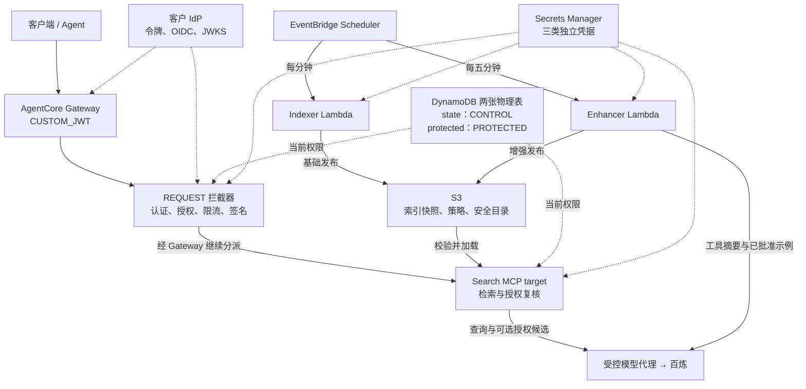
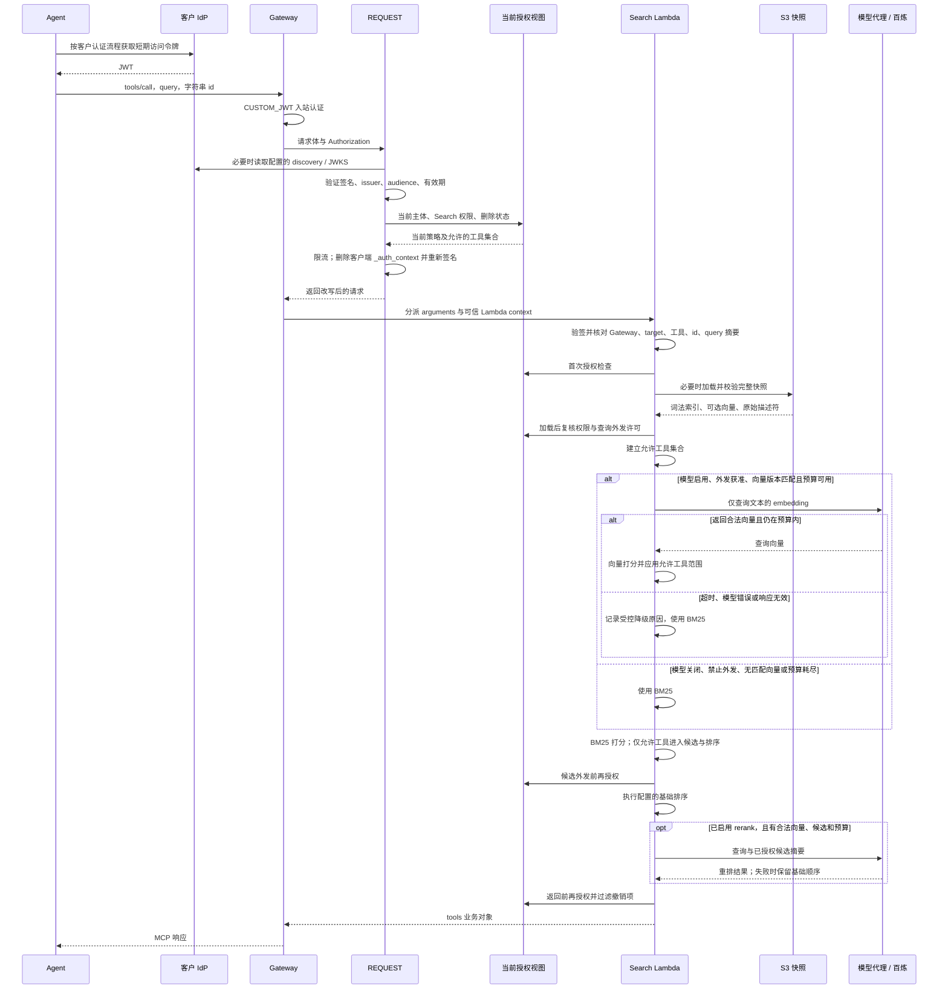
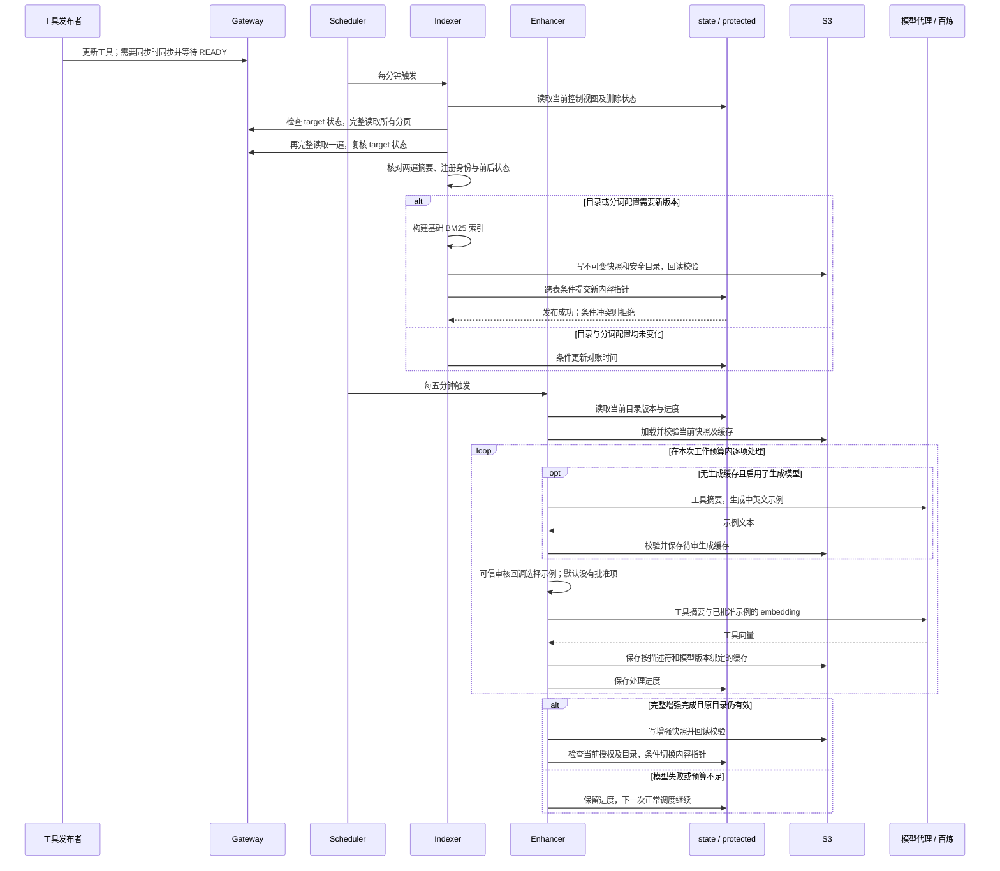
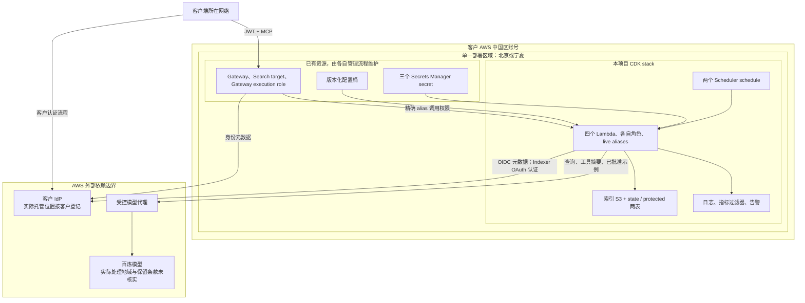
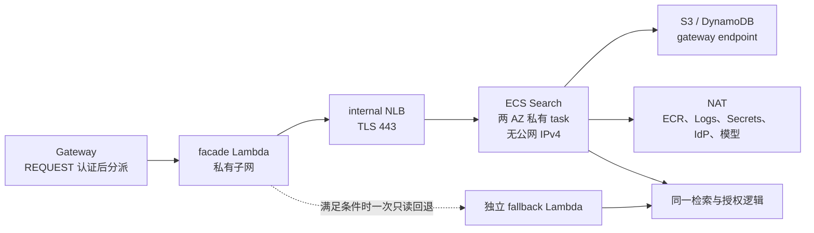

# 系统架构

本项目为中国区 AgentCore Gateway 增加工具语义搜索，让 Agent 按需找到工具，减少加载全量工具目录的开销。搜索、模型调用和最终返回都受服务端权限控制；总体目标见[项目总览](overview.md)。本文面向客户架构师和维护本仓库的开发者。读完后，你可以说明在线搜索、后台索引和权限校验怎样配合，并判断一次部署涉及哪些资源和外部服务。

## 先理解四个组件

Agent 先提交一句工具需求，再用搜索结果中的完整名称调用业务工具。语义搜索只负责发现工具，不执行业务操作，也不替代业务工具对订单、文件等资源的权限检查。

| 组件 | 负责什么 | 什么时候运行 |
|---|---|---|
| REQUEST 拦截器 | 在 Gateway 分派请求前验证身份、检查工具权限、限流；为 Search 写入可信身份封套 | 每次 MCP 请求进入 Gateway 后 |
| Search MCP target | Gateway 的工具后端入口；默认调用 Search Lambda，启用 ECS 时调用 facade Lambda，再选择 ECS 或安全的 Lambda 回退 | Agent 调用搜索工具时 |
| Indexer | 读取完整工具目录，构建不依赖模型的关键词索引 | Scheduler 定时触发 |
| Enhancer | 读取已发布目录，生成工具向量；生成的示例问句先进入待审缓存 | 单独的 Scheduler 定时触发 |

MCP 是 Agent 列出和调用工具的协议。这里的“语义搜索”通过 embedding 实现：模型把文本转换成数字向量，检索时比较这些向量。模型关闭或不可用时，服务可以使用 BM25，按查询与工具文本中的词进行排序。实现入口见[运行时](../src/semantic_service/runtime.py)、[拦截器](../src/semantic_service/interceptor.py)和[搜索处理器](../src/semantic_service/search.py)。

索引快照是一版工具目录及其检索数据的文件集合，保存在 S3 中。DynamoDB 保存当前使用哪一版内容和权限的指针。基础四个 Lambda 都通过 `live` alias 绑定已发布版本；可选 ECS 另有 facade 与独立 fallback Lambda。alias 是稳定的调用名称，部署时可切换其指向的版本。资源定义见[存储](../infra/storage.py)、[函数](../infra/functions.py)和[ECS 资源](../infra/ecs_search.py)。

## 名词解释

| 名词 | 是什么、何时发生 | 耗时与优化边界 |
|---|---|---|
| 冷启动 | Lambda 需要建立新的运行环境并加载代码。空闲后或扩容时的请求可能遇到 | 最新测量与目标见[已知限制](known-limitations.md)；不能用热请求耗时代替 |
| 热请求 | 请求复用已有运行环境，通常能复用客户端、密钥缓存和已加载索引 | 仍可能刷新密钥或索引；耗时以对应样本测量为准 |
| 平台初始化（Init Duration） | AWS 准备运行时并执行函数初始化阶段。平台日志报告这段时间 | 应用代码不能直接控制环境分配；包加载和初始化代码可以优化。它不等于下面的首次初始化 |
| 首次初始化（handler factory） | 构造处理器、配置和客户端；按需环境首次进入入口时执行，REQUEST PC 环境在 Init 预建 | 记录在 `handler.factory`；必须按环境区分 Init 与调用内成本 |
| 预置并发 | Lambda 提前初始化一定数量的执行环境 | REQUEST 示例默认 0；容量外仍可按需冷启动，且不预建 signing secret |
| p50 / p95 | 一组耗时从小到大排列后，分别有约 50% / 95% 的请求不超过该值 | p95 反映较慢请求；不同阶段的 p95 不能直接相加 |
| embedding | 把查询或工具文本转换为向量，用于按含义比较 | 查询阶段有独立预算；超时可退回 BM25，详见[模型诊断](embedding-diagnostics.md) |
| 降级（BM25） | 所需向量能力失败或不可用后，用关键词排序继续提供结果 | 权限检查照常执行；模型有意关闭、低相似度下正常选择 BM25，与模型故障应分开看 |
| 拦截器 | Gateway 在处理请求时调用的检查和改写函数；本项目使用 REQUEST 阶段 | 增加认证、授权和限流耗时；不能为减少延迟省略安全检查 |
| MCP target | Gateway 注册的工具后端；默认绑定 Search Lambda，启用 ECS 时绑定 facade alias | Gateway 分派和网络耗时需用客户端测量，不能只看 Lambda 日志 |
| OIDC | 用受信任的身份服务发布元数据、支持令牌验证的身份协议 | 冷缓存或公钥刷新时会读取配置的身份端点；端点耗时不是固定值 |
| JWKS | 身份服务发布的公钥集合，用来验证 JWT 签名 | 本项目缓存有期限，未知密钥会受控刷新；不能使用过期缓存绕过验证 |
| 条件提交（CAS） | 只有当前状态仍与读取时一致，才允许写入新状态 | 用来防止并发发布覆盖新目录或新权限；冲突时放弃旧产物 |
| 永久删除标记（tombstone） | 确认 Gateway 删除后保存的状态，阻止旧任务重新发布 | 不自动过期，内容回滚也不能清除它 |

平台与应用计时的精确包含关系见[服务说明中的冷启动分段计时](service.md#冷启动分段计时)和[计时实现](../src/semantic_service/runtime.py)。本表未给每个阶段设定未经测量的固定耗时。

## 系统总览

下面展示主要逻辑连接。Gateway 先调用 REQUEST，收到改写后的请求，再分派到 Search target。虚线表示身份、权限或凭据依赖，不表示四个函数拥有相同权限。为便于阅读，图中省略配置桶、Indexer 的令牌获取与目录读取，以及后台发布的条件检查；这些细节见后面的时序图、部署拓扑和图后权限说明。

state 与 protected 是两张物理表。`CONTROL` 保存当前内容指针；`PROTECTED` 保存策略指针、策略版本和永久删除标记。授权策略正文保存在不可变 S3 对象中。四个运行角色不能写 protected 表；只有独立授权管理员能改变其权威状态。索引发布通过跨表事务检查当前权限和删除状态，再更新内容指针。详见[存储边界](service.md#control-与-protected)和[基础设施权限](../infra/stack.py)。

图中的 Secrets Manager 连线只表示按角色读取。Search 与 REQUEST 读取签名密钥；Indexer 读取 OAuth 凭据；模型启用后 Search 与 Enhancer 才能读取模型凭据。精确清单见[安全与数据流](security-and-data-flow.md#密钥清单与轮换)。

## 一次工具搜索怎样完成

普通身份的 `tools/list` 只返回 Search 工具，且没有下一页。Agent 通过这个入口搜索业务工具，再按结果中的完整 `name` 调用。Indexer 使用单独的机器身份，才可以读取完整目录；该身份不能调用业务工具或 Search。[拦截器实现](../src/semantic_service/interceptor.py)规定了这两条路径。

当前服务默认 `SEMSEARCH_FUSION_STRATEGY=vector_bm25_fallback`：向量相似度足够时优先按向量排序，低相似度且存在正向词法匹配时选择 BM25。模型完全不可用时使用 BM25。`rrf` 是可选模式，将两路排名融合；它是核心库默认值，不是服务默认值。全局模型默认关闭，`MODEL_RERANK_ENABLED` 默认也为 `false`。默认值与排序行为分别见[配置解析](../src/semantic_service/config.py)和[检索核心](../src/semantic_core/search.py)。

授权在候选筛选之前确定。BM25 使用同一 Gateway 完整目录的词频统计，然后屏蔽无权工具；这不代表每个主体都有独立统计索引。未经授权的工具不会进入返回列表或 rerank 候选。若身份、权限或索引完整性无法验证，请求直接失败，不能以 BM25 或空列表掩盖。授权复核不能撤回之前已经发往模型的数据，也不能保证最终检查之后才发生的撤销立即影响本次返回。边界见[安全与数据流](security-and-data-flow.md#认证与授权链路)。

成功业务对象只含工具描述符列表。排序模式、降级原因和性能字段留在服务日志，不加入成功响应。客户端需要先检查 JSON-RPC 错误与 `result.isError`，再解析支持的 MCP 文本 JSON 包装；HTTP 成功本身不代表工具成功。完整示例见[用户手册](user-guide.md)。

## 索引怎样构建和增强

基础索引不调用模型。工具发布者先让 Gateway 看见最新目录，Indexer 再读取、校验和发布。Enhancer 只增强已经发布的目录；因此外部模型故障不会阻止基础目录进入关键词检索。

Indexer 默认每 60 秒触发，一次工作预算为 45 秒。Enhancer 默认每 300 秒触发，一次工作预算为 240 秒；含义是每轮处理有上限，不是承诺在这个时间内完成全部目录。两个后台函数的预留并发各为 1；Scheduler 与 Lambda 异步重试均为 0，过期事件不反复重放。调度值来自[调度资源](../infra/scheduling.py)，工作预算来自[Indexer](../src/semantic_service/indexer.py)和[Enhancer](../src/semantic_service/enhancer.py)。

当前运行时没有配置可信审核回调。生成示例会保存在待审缓存，但不会自动参与检索；真实工具摘要仍可生成向量。若目录版本在增强途中改变，旧进度和旧快照不能覆盖新目录。分词配置迁移由 Indexer 建立新目录版本，Enhancer 沿用该版本的分词配置。详见[增强入口](../src/semantic_service/runtime.py)和[条件发布实现](../src/semantic_service/storage.py)。

Search 以请求驱动方式检查内容指针，默认最长每 30 秒检查一次；权限或安全目录版本变化会触发同步检查。这不是“工具更新后 30 秒内一定可见”的承诺：上游同步、下一次轮询、完整读取和发布也需要时间。快照必须通过对象版本、字节数、摘要和索引结构校验后才能整体替换。[SnapshotReader](../src/semantic_service/storage.py)是这一行为的实现依据。

## 部署在哪里，哪些资源由本项目管理

一套 stack 绑定一个 AWS 账号、一个中国区 Region 和一个 Gateway。区域选择为北京 `cn-north-1` 或宁夏 `cn-northwest-1`；部署到另一区域需要另一套明确配置和独立验证。当前 CDK 没有跨区复制或自动灾备切换。[部署配置](../infra/config.py)和[stack](../infra/stack.py)会核对账号、区域与资源身份。

`ecs_search` 可选且默认关闭。下面的基础图表示关闭 ECS 时的四函数部署；启用后增加
facade、独立 fallback、ECS 服务、internal NLB、私有子网及端点等资源，见后面的 ECS 路径。

| 边界 | 当前实现 | 客户需要确认什么 |
|---|---|---|
| Gateway 和身份服务 | 复用已有 Gateway、Search target、执行角色与 IdP；CDK 给已有执行角色附加指定 Search/REQUEST alias 的调用权限 | 实际 `CUSTOM_JWT` 配置、请求头传递、信任策略和 target 绑定 |
| 计算和存储 | 基础四个独立运行角色；ECS 模式增加 facade/fallback 与 task 角色；每 Gateway 一套索引桶、state 表和 protected 表 | 配额、初始授权、资源名称及保留策略 |
| 网络 | 默认 Lambda 不配置 VPC；ECS 模式使用下面的私网入口及受控 HTTPS 应用配置，不跟随重定向 | IdP 必须能被 Gateway 服务访问；NAT 允许的 HTTPS 出站不等于网络域名允许清单 |
| 外发数据 | 查询 embedding、工具摘要 embedding、可选生成和 rerank 经配置的代理到模型服务 | 代理及后端实际地域、数据保留和处理条款；不能由模型名称推定 |
| 另一区域或账号 | 代码显式绑定区域和账号，默认不跨 Gateway 聚合 | 另建配置和资源并验收；账号隔离不会自动完成数据迁移 |

这里的 IdP 和模型依赖是逻辑服务边界，图不证明供应商的实际基础设施地点。OAuth 凭据与模型认证凭据会分别发送到其指定认证或模型端点；签名密钥不发送给这些端点。数据字段、外发控制和日志边界见[安全与数据流](security-and-data-flow.md)。

facade 对接 Gateway 的既有 Lambda target 契约；NLB 443 只允许 facade 安全组，
task 的服务与健康端口只允许 NLB 安全组。ECS 工作进程预载配置和快照后接纳请求；
明确拒绝或已完成结果不回退，网络超时等允许一次只读 fallback，仍可能与结果未知的 ECS
执行重复，不保证跨后端 exactly-once。私有子网与 S3/DynamoDB 端点减少公网
暴露和部分 NAT 流量，但其余 HTTPS 出站仍需 NAT；细节见[ECS 设计](ecs-search-design.md)。

REQUEST 与 Search 后端开关独立。`request_package="request"` 且
`request_provisioned_concurrency>0` 时，PC Init 在父进程预建 factory，再以独立
HTTP 客户端与 verifier 预取 discovery/JWKS，完成后关闭独立客户端；signing secret
不预取。示例默认预置并发为 0。预取软截止及缓存/失败边界见
[服务配置](service.md#冷启动分段计时)，启用前核对[已知限制](known-limitations.md)。

## 关键设计决策

完整决定与待确认项以[详细设计](design.md)为准。下表只说明这些决定对当前使用方式的影响。

| 决策 | 当前选择及影响 | 进一步阅读 |
|---|---|---|
| 身份入口 | `CUSTOM_JWT` 配合 REQUEST 验证和签名封套；客户端不填写身份参数 | [安全与配置](security-and-data-flow.md) |
| 客户端发现方式 | 普通列表只有 Search；自有 Agent 按搜索结果调用完整工具名 | [客户端边界](design.md#2-同一套-agent-如何使用) |
| 模型与降级 | 使用配置的模型代理；rerank 默认关闭；向量故障保留受权限限制的 BM25 | [安全与配置](security-and-data-flow.md) |
| 目录更新 | 定时完整读取，基础索引先发布，后台增强独立继续 | [安全与配置](security-and-data-flow.md) |
| 授权和内容分离 | protected 独立物理表；恢复内容不能恢复旧授权或清除删除标记 | [安全与配置](security-and-data-flow.md) |
| 上线放行 | 实际吞吐、延迟、质量、配额和模型预算要分别验收 | [已知限制](known-limitations.md)、[容量](capacity.md)、[配额](quotas.md) |

具体部署操作从[运维手册](operations-runbook.md)进入；资源参数和恢复步骤引用[部署说明](deploy.md)，避免维护两份细节。
