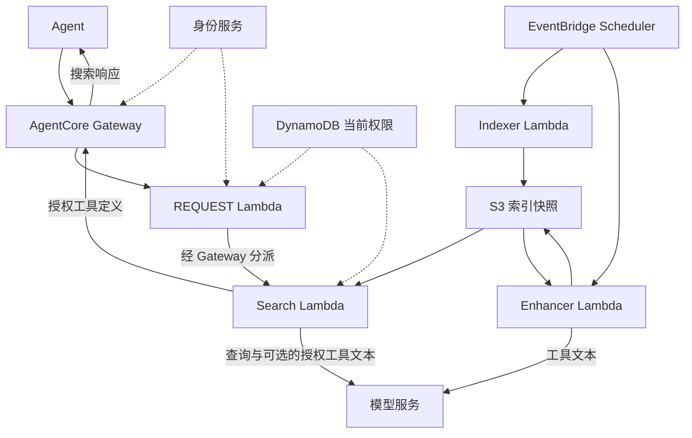

# 在中国区为 Amazon Bedrock AgentCore Gateway 增加按权限过滤的工具语义检索

> 本文配套仓库为样例代码，非生产用途，部署前请与贵司安全与法务团队确认合规要求。你需要自行完成安全审查，并承担部署、调用产生的费用及资源清理责任。

Agent 要“修改商品信息”，却要先读完整个工具目录；查询、修改、删除工具的名字又很相似。工具越多，模型要读的内容越长，也可能选错动作。这个方案让 Agent **先搜索，再调用**，搜索结果只包含当前身份有权使用的工具。

在 500 个工具、30 条合成查询的实验中，模型输入 token（模型处理文本的计量单位）从约 58,209 降到 745，选工具耗时的中位数从 8.7 秒降到 1.6 秒。代价是选对率从 86.7% 降到 60%。搜索返回的工具列表称为候选，正确工具只出现在 18/30 次候选结果中，检索遗漏是首先要解决的问题。

截至 **2026-10-19** 核对，[AWS 中国区功能差异说明](https://docs.amazonaws.cn/aws/latest/userguide/bedrock-agentcore.html)列明，中国（北京）和中国（宁夏）区域不提供原生工具语义搜索；已有原生能力的区域优先使用原生功能。

## 怎么用：先找工具，再执行业务操作

客户端沿用 MCP（Agent 列出和调用工具的协议）。初始化后，用 `tools/list` 取得搜索入口，再发送下面的 JSON-RPC（用 JSON 表达远程调用）请求。将 `name` 换成返回的完整名称，并在 HTTP 请求头携带有效访问令牌：

```json
{
  "jsonrpc": "2.0", "id": "search-1", "method": "tools/call",
  "params": {"name": "discovery___search_tools", "arguments": {"query": "修改商品信息"}}
}
```

- 查询填写非空白文本，省略由服务端生成的 `_auth_context`；`tools/list` 返回的 schema（工具参数定义）不含长度约束，客户端自行校验，详见[用户指南](../user-guide.md)。
- 检查 HTTP 状态码、JSON-RPC `error`、响应 `id` 是否匹配，以及 `result.isError`。
- 按实际响应形状提取文本、解析 JSON，再读取 `tools`；其中包含工具的完整名称、描述和参数定义。
- 检查失败或响应无法解析时，停止后续业务工具调用。
- 超时既不等于失败，也不等于成功；有副作用的调用先确认执行结果和重复执行的影响，再决定是否重试。

## 架构：搜索在线运行，索引在后台更新



图中是默认纯 Lambda 路径；定时调度、模型调用和模型重排（再次调整候选顺序）默认关闭。REQUEST 在 Gateway 分派前验证身份、检查工具权限。Search 查找相关工具，并在返回前复核权限。Indexer 读取完整目录，发布不依赖模型的关键词索引。Enhancer 把工具文本转成表示语义的数字向量，补充到已发布索引中。

目录更新和向量增强分开运行，模型故障不会阻断基础关键词搜索。REQUEST 支持预置并发预热，即提前准备执行环境；Search 尚未做同类改造，细节见[服务配置](../service.md#冷启动分段计时)。

## 三个关键设计取舍

### 权限贯穿工具发现与调用

工具名称和参数也可能包含内部信息，因此先过滤无权工具，再选出候选，业务调用时再次检查工具权限。接入需要 `CUSTOM_JWT`（自定义令牌授权器），以及支持 OIDC 身份认证协议的 IdP（身份提供商）；中国区不能使用 Cognito 用户池。身份服务的 discovery 提供元数据，JWKS 提供验签公钥，两者必须从 Gateway 服务侧经公网 HTTPS 可达。对你意味着什么：工具权限由这条链路检查，订单、文件等具体资源的权限仍由业务工具检查，详见[安全与数据流](../security-and-data-flow.md)。

### 模型不可用时自动退回关键词搜索

向量不可用时，Search 自动退回 BM25（按关键词匹配打分的传统检索算法），继续在授权范围内查找工具。此时同义改写可能漏掉，运维应对模型故障降级单独告警。每个调用者的 `allow_query_egress` 开关控制是否把查询文本发给模型服务，部署级模型开关控制后台是否外发工具文本。对你意味着什么：可以先用关键词搜索接入，再开启模型能力；数据处理和存储地点按[数据外发说明](../security-and-data-flow.md#哪些数据会离开-aws)核对。

本文的模型调用通过兼容 OpenAI 接口的代理访问阿里云百炼，这是非 AWS 模型服务。启用相应模型功能且允许外发后，查询文本会用于查询向量和可选重排，工具文本会用于后台向量生成、示例查询生成和可选重排；这些文本会离开 AWS。开启前，请确认代理与模型服务的数据处理、存储、保留和训练条款符合你的要求。

目标服务返回的工具描述是不可信输入，其中可能夹带诱导 Agent 忽略指令或执行其他动作的提示注入内容。Agent 应将这些描述当作待判断的数据，不能当作系统指令；搜索结果通过权限检查，也不代表描述内容可信或业务动作已获用户同意。

### 索引可更新，也可回滚

索引以不可变快照保存：每版目录独立存放，发布时切换当前使用的版本。目录更新不必等待向量增强，回滚内容也不会恢复旧权限。对你意味着什么：可以分别管理目录发布和模型增强，但调度间隔不等于工具变更的可见时间，需测量从上游更新到搜索可见的全过程，详见[目录与调度](../service.md#目录与调度)。

## 部署形态

默认使用纯 Lambda，ECS（容器运行服务）是可选搜索后端。两种后端需要按相同负载分别验证，不能由部署形态推断性能。部署关系见[ECS Search 设计](../ecs-search-design.md)，切换步骤见[迁移至纯 Lambda](../migrate-to-lambda.md)。

## 实测效果：输入更少、选择更快，选对率也下降

合成实验覆盖 20、50、100、200、500 个工具五档规模，每档使用相同的 30 条配对查询，包含中文、英文和中英混合表达。实验由 `qwen-plus` 选工具、`text-embedding-v4` 生成向量，采用与当前服务默认不同的旧版排序，关闭重排。下表是 **500 个工具**时的结果，p50 表示耗时中位数。

| 指标 | 完整加载工具 | 先搜索再选择 |
| --- | ---: | ---: |
| 平均模型输入 token | 58,209.2 | 744.6 |
| 检索与选择耗时 p50 | 8.744 秒 | 1.602 秒 |
| 选工具准确率 | 86.7%（26/30） | 60.0%（18/30） |
| 每次提供的候选数 | 500 | 5 |
| 候选中包含正确工具的查询数 | 30/30 | 18/30 |

输入 token 减少约 98%，耗时缩短到约五分之一，选对率却下降 26.7 个百分点。候选命中只有 18/30，说明应优先补足检索遗漏。搜索开始更快的转折出现在 20 与 50 两个工具规模测试点之间。这里的 token 只计选择模型输入，耗时包含搜索组的检索与两组的模型选择，不含 Gateway、建索引和业务执行，完整统计见[工具规模实验](../../reports/real/knee-comparison.md)。

## 接入前你要验证什么

- 用真实目录和查询验证能否搜到、选对并成功调用工具，覆盖权限拒绝；旧版合成实验不能替代验收，小目录的检索开销也可能抵消收益。
- 测量长期闲置后的首批和突发并发延迟，结合初始化日志区分冷暖，避免用热请求估算用户等待。
- 验证你的 IdP 的 JWKS、密钥轮换与预热兼容性，因为普通请求验签成功不代表预热读取也成功。
- 模拟模型故障，检查关键词结果、无匹配时的误推荐和告警送达；权限或索引校验失败必须拒绝，不能靠降级放行。
- 核对查询、工具文本的外发开关和模型服务的实际处理与存储地点、保留及训练条款，模型名称不代表数据所在地域。
- 若选择 ECS，先修复并验证[已知缺陷](../known-limitations.md)，当前故障回退并非在所有故障下可靠。

## 费用与资源清理

默认栈包含 Lambda 函数、S3 索引桶、两张 DynamoDB 表、CloudWatch 日志、指标和告警，以及 EventBridge Scheduler 调度。调用、存储、备份和监控会按实际使用计费；启用预置并发会增加相应费用。已有的 Gateway、Secrets Manager 和外部身份服务也需计入使用成本。开启模型能力还会产生代理和阿里云百炼的费用。

可选 ECS 后端还会部署 Fargate 服务、NLB、两个 NAT Gateway、重放状态表和 VPC Flow Logs。持续运行的计算和网络资源即使没有搜索请求也可能计费；流日志还会增加 CloudWatch 日志的写入和存储费用，默认保留 30 天，可通过 `log_retention_days` 调整。

实验结束后，`cdk destroy` 不会清除全部数据：S3 桶、DynamoDB 表和 CloudWatch 日志组采用保留策略，表还启用了删除保护。保留的存储和备份可能继续产生费用。Lambda 旧版本在函数存续期间可因更新而保留，但删除整个函数会同时删除其全部版本和别名，不能依靠版本保留策略在销毁后恢复函数。清理前先停用入口、调度及管理写入，排空在途请求，保留最新授权和撤销记录；再根据活动索引、配置引用和读取窗口列出可删除对象，由获授权的独立角色审核并清理。不要直接按时间批量删除，也不要用旧权限快照恢复服务。OAuth 和模型服务的上游凭证需要分别协调撤销。完整步骤见[运维手册：清理或退役环境](../operations-runbook.md#我要清理或退役环境)。

## 总结

工具多时，先搜索再选择可以减少模型输入和等待。检索漏掉正确工具，也会拉低最终选对率。先用真实目录验证质量、权限和等待时间，再决定节省的开销是否值得增加一层检索。
