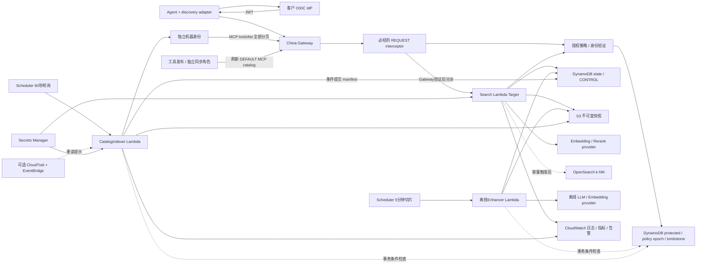
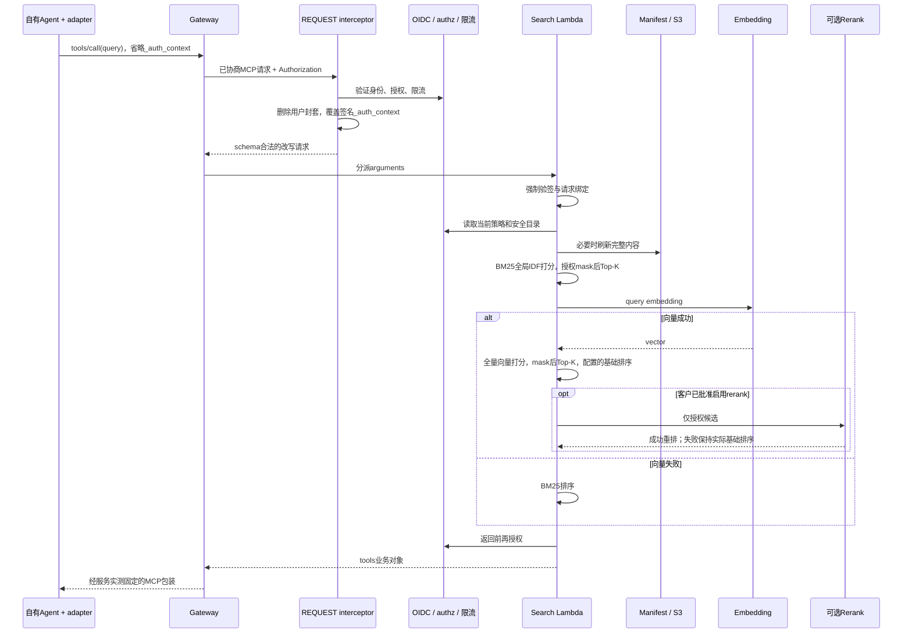
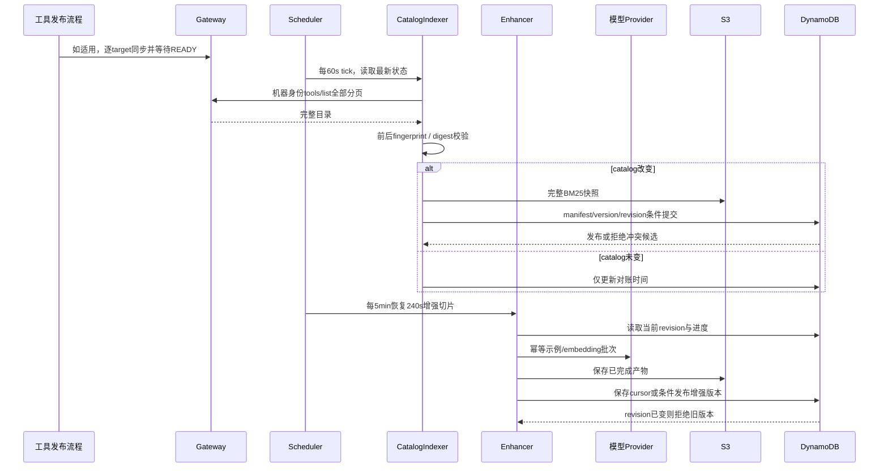

# AgentCore Gateway 工具语义检索替代方案

本文保留方案的技术设计与规划假设，供架构师与维护者核对技术边界。它是[项目总览](overview.md)中目标与范围的依据，设计假设不等于已达成的线上结果。读完后，你可以审查检索、授权、存储和容量选择，并确认哪些事项仍需客户决定。适用边界请结合[已知限制](known-limitations.md)阅读。

技术栈为 Python 3.12、AWS CDK（Python）和 pytest。以下容量、预算与验收数值为设计假设；功能适用性须在你的目标账号核对。

## 1. 目标、边界与规模

本节热 p95 1.5 秒、冷 p95 4 秒是规划目标，不是已达到的结果。ECS 与 REQUEST 预置并发均为默认关闭的选项。当前拓扑见[系统架构](architecture.md)。

为 AWS China 的多个 AgentCore Gateway 提供工具发现样例。Search 作为每个 Gateway 的 Lambda Target，暴露 `search_tools`；Indexer 使用独立机器身份读取该 Gateway 的完整 MCP catalog。服务默认 `vector_bm25_fallback`，两项拒答门槛不设置、rerank 关闭；启用后 rerank 失败保留实际基础排序，向量不可用时退回 BM25。核心库默认仍为 RRF。调用方只能发现和调用其有权使用的工具。

中国区功能差异以目标服务的公开文档及你的账号验证结果为准。本设计的公开资料核对时点为 2026-10-10，不作未来路线图承诺。[AWS-CN]

目标：

- 对同一份 Agent 业务逻辑，Global 使用原生工具，China 使用替代工具；通过很薄的 discovery adapter 处理名称和返回格式差异。
- 将工具更新、删除、模型失败、重复事件、并发索引构建和身份撤销纳入正常运行流程。
- 在缺少向量、rerank 或离线 LLM 的情况下仍可提供受权限约束的词法检索。
- 以可重复评测和容量实验决定扩容，保持 S3 与 OpenSearch 后端可替换。

非目标：实现原生服务的未公开排序算法；声称 wire-level 完全兼容或 Global/China 同吞吐；兼容任意 MCP 客户端；跨 Gateway 默认聚合搜索；为 DYNAMIC listing 或随调用者变化的 schema 建共享索引；替代业务工具自身的授权。普通身份只从 `tools/list` 获取 Search bootstrap，业务工具通过客户自有 Agent 的 discovery adapter 发现并调用；不能假设第三方 MCP 客户端会调用列表中没有的名称。

| 项目 | 规划基线 | 容量验证范围 / 目标 |
|---|---|---|
| 工具数 | 500 tools/Gateway | 100、500、2,000、5,000、10,000、20,000；均在100 targets×1,000 tools/target的组合上限内，分布/单schema大小另受限制 |
| Gateway 数 | 20，总计约 10,000 tools | 100；每个 Gateway 分开计算索引和吞吐 |
| 查询流量 | 每 Gateway 稳态 2 QPS，总计 40 QPS | 单 Gateway 20 QPS 突发 5 分钟；总计 200 QPS，需配额和预算支持 |
| 更新流量 | 每 Gateway 每天约 10 次变更 | 同一 Gateway 100 次/分钟突发，合并构建 |
| 查询延迟 | 无刷新 warm p95 ≤ 1.5 s，p99 ≤ 3 s | 包括Gateway、授权和provider；已进入BM25模式p95≤400ms；首次超时计入端到端分布 |
| 冷启动 / 命中刷新 | 两类分别报告，p95 ≤ 4 s、p99 ≤ 6 s | 所有请求仍计入总体p95≤2s、p99≤6s；不得用分类排除掩盖慢请求 |
| 可用性 | Search 月度 99.9%（包括合法的 BM25 降级） | 身份/权限不可验证时拒绝服务，不能为达可用性指标越权 |
| 目录新鲜度 | Gateway catalog 可见变更到用户可检索 p95 ≤ 4 min | 基于60s轮询、Scheduler精度、完整抓取/基础发布和reader刷新预算，待评测实测；不是CloudTrail延迟承诺 |
| 质量 | 对 `1 ≤ relevant_authorized数量 ≤ 5` 的query，macro Recall@5 ≥ 0.90 | `>5` 的query另设Hit@5≥0.95并报告Recall理论上限；中/英分组、分母及占比单列，越权泄露必须为0 |

冷启动的规划预算为运行时初始化 0.5 s、加载/校验 1.0 s、普通请求路径 1.5 s、余量 1.0 s；刷新请求规划为加载/交换 1.5 s + 请求路径 1.5 s + 余量 1.0 s。分项预算不是分位数可相加的统计证明，评测必须测端到端分布。2 s 加载值是迁移评估阈值，不是冷启动的正常期望。

### 1.1 服务配额与容量计划

官方默认配额按 Region 设置，下表是公开默认值，**不是客户账号已取得的额度**。China 实际生效值、可提额幅度、目标账号其它业务占用需在获授权的后续阶段确认，目标账号的有效配额须自行核实。[AWS-QUOTAS]

| 配额 | 公开默认值 / 作用域 | 需求与动作 |
|---|---|---|
| tool-call / tool-list | 200 TPS/Gateway；另有200 TPS/account/Region，均可调整 | Search、业务调用、bootstrap列表、Indexer分页和重试共享账号额度；多Gateway不能隔离账号限流 |
| 原生 search-based tool-call | 25 transactions/min，可调整；该行未注明account/Gateway作用域 | 单Gateway 2QPS=120TPM已是4.8倍；若为账号共享，20个Gateway的2,400TPM为96倍。确认作用域并提额前不得承诺Global同负载 |
| targets / tools | 100 targets/Gateway，1,000 tools/target，可调整 | 20k工具至少按20个target分布，不需因“20k总工具数”本身提额；另验schema/payload |
| 同Gateway并发target操作 | 合计5个Create/Update/DeleteTarget，可调整 | 发布流程默认最多4个在途，留1个操作余量；100次/min突发必须排队，不能承诺都在2min内READY |
| schema | inline 1 MB；S3 schema 10 MB，可调整 | 不能仅凭工具数推导可装入；逐target计算序列化字节 |
| tool-call/tool-list/tool-search payload | 公开配额6 MB，可调整 | 输入字节、Lambda输出提交和最终MCP包装分开计量，不能视为对称HTTP上限；应用保留更小预算，见配额工作表 |

容量公式以请求数而非最终用户数计算：`T = (Q_search + Q_business + Q_bootstrap + G×P/60) × (1+r)`，其中 `P` 是每Gateway每轮两次完整读取的总list调用数，`r` 为重试预留。目标额度 `quota ≥ T/0.70`（30%余量为待客户确认的规划值）。控制面Get/List与初始化协议有各自配额/计费，另列，不能混成免费流量。

算例取每次搜索随后2次业务工具调用、bootstrap均摊1 TPS（100-Gateway档取5）、重试10%。分页大小以实际响应为准；测试使用独立合成分页输入。保留512KiB业务响应和6MiB本地list响应预算；大list、Unicode/转义及interceptor边界另验。

## 2. 同一套 Agent 如何使用

业务代码只调用 discovery abstraction：`discover(query) → ToolDescriptor[]`，并使用描述符的原始名称调用工具。backend profile 负责 `native-global` / `custom-china` 的实际名称、调用封装及结果解码；China profile从不填写 `_auth_context`。Gateway endpoint、认证和profile由配置选择。统一业务代码不代表同一schema字节、吞吐或无需提额；Global原生25TPM与China普通tool-call配额分别遵守第1.1节。

普通身份 `tools/list` 由已鉴权的REQUEST interceptor短路为**单页Search bootstrap，无nextCursor**；只包含它有权调用的Search descriptor。Indexer身份才读取Gateway全量分页。自有Agent经Search发现业务工具后可直接按返回全名调用；不支持依赖完整 `tools/list` 的任意第三方客户端。Global原生输出fixture未补齐前，只承诺abstraction设计。

## 3. 架构、区域与信任边界

### 3.1 中国区事实

AWS China 使用 `aws-cn` 分区、`arn:aws-cn:` ARN；AWS区域endpoint使用 `amazonaws.com.cn` 后缀。CDK从partition/region/URL suffix token和实际gatewayUrl生成引用，不硬编码Global ARN/STS/Gateway host。[AWS-ARN] [AWS-ENDPOINTS]

| 服务/能力 | 两区可用性查证结果 | 本设计边界 |
|---|---|---|
| AgentCore Gateway | 北京、宁夏；semantic search、Gateway rules、WAF integration不可用；必须CUSTOM_JWT或AWS_IAM [AWS-CN] | rules是路由/configuration覆盖，不是授权；本设计用interceptor授权，不用WAF限流 [AWS-RULES] |
| S3、Lambda、Secrets Manager、KMS、EventBridge、SQS、DynamoDB | 两区服务可用；各官方来源列于第11节 [CN-S3] [CN-LAMBDA] [CN-SECRETS] [CN-KMS] [CN-EVENTBRIDGE] [CN-SQS] [CN-DDB] | 客户资源配置与账号配额仍需逐区验收，不把一般服务能力继续列为未知 |
| DynamoDB | 条件写、事务、单区强一致读可用；仅Global Tables MRSC不可用 [CN-DDB] | 强读用基表/LSI，不用GSI；事务成本计双底层读写 [AWS-DDB-TX] |
| EventBridge / Secrets轮换 | EventBridge明确两区无服务差异；Secrets一般轮换无中国区限制 [CN-EVENTBRIDGE] [CN-SECRETS] | 不能据此保证AgentCore事件格式/延迟；模型服务凭证仍需供应商侧轮换流程 |
| private IdP / 其它AgentCore能力 | private IdP configurations、Memory、Policy、Harness、Payments、Knowledge Bases、Evaluations、Optimizations、Registry不可用 [AWS-CN] | 需提供Gateway服务侧可达的公网HTTPS discovery/JWKS，服务仍做真实验证；仅给Lambda配VPC不能解决私网IdP问题 |
| Cognito | 中国区文档仅列北京，且 User Pools 不可用；AgentCore 中国区明确不能用 Cognito user pool 作 CUSTOM_JWT provider [AWS-COGNITO] [AWS-CN] | Cognito 仅为 Global OIDC 示例，不能作为 China 的可部署默认 IdP |
| Gateway REQUEST/RESPONSE interceptors | REQUEST 转换与 Lambda 分派须在目标配置验证 [AWS-INTERCEPT] [AWS-CN] | 保留可选schema与严格封套绑定；CUSTOM_JWT/header/alias/签名字符串完整链路仍待生产配置验证 |
| OpenSearch Service | 北京、宁夏服务可用 [CN-OPENSEARCH] | 所选版本 k-NN、过滤能力、实例和容量**未证实**；不等同于 Serverless 可用 |
| SageMaker AI | 两区可用；Serverless、Inference的g5/p4d/Graviton/Inferentia、GPU多模型、增加shared memory不可用；三个EndpointConfig参数不支持，见第6.3节 [CN-SAGEMAKER] | 自托管模型由部署方选定并实测，实例/容器组合须验证 |
| X-Ray / Lambda Function URL / SQS redrive | Lambda中国区无X-Ray integration、Function URLs；SQS DLQ redrive不可用 [CN-LAMBDA] [CN-SQS] | 默认用CloudWatch日志；仅可选事件链启用DLQ时提供受控重放，不依赖托管redrive |

### 3.2 组件和数据流

每Gateway由基础设施创建独立Search/REQUEST、CatalogIndexer、离线Enhancer、S3 bucket及运行角色；两个后台函数各自reserved concurrency=1。DynamoDB为独立state和protected两张物理表，替代同表PROTECTED的LeadingKeys隔离。state保存CONTROL/rate/cache/progress，protected只保存管理员专写的授权与永久tombstone；角色/key仍带account/region/gatewayId，外部query不接受gatewayId。四函数明确绑定不同的两个表，不自动回读旧表；独立账号等扩展另行批准。资源隔离不能隔离第1.1节账号级TPS。

图表示必经的逻辑执行链：实际Lambda分派仍由Gateway完成，不给interceptor任意invoke权限。普通列表在REQUEST阶段直接返回bootstrap；Search调用经身份校验和封套覆盖后才分派。默认无RESPONSE分页过滤、CloudTrail事件链或SQS；可选组件另行批准。默认使用 CUSTOM_JWT；仅当后续安全探针证明既定路径不成立时另行评估proxy，并保证不可直连绕过。

### 3.3 Lambda Target 的真实输入

官方 Lambda Target 文档明确：`tools/call.params.arguments` 中的字段直接成为 Lambda 的 `event`。本例 Search 收到 `{"query":"查找可以取消订单的工具"}`，不是 API Gateway 的 `body` 字符串，也不是完整 JSON-RPC envelope。[AWS-LAMBDA]

官方 `context.client_context.custom` 列出的字段为 `bedrockAgentCoreMessageVersion`、`bedrockAgentCoreAwsRequestId`、`bedrockAgentCoreMcpMessageId`、`bedrockAgentCoreGatewayId`、`bedrockAgentCoreTargetId`、`bedrockAgentCoreToolName`。工具名从 `bedrockAgentCoreToolName` 读取；官方命名格式为 `${target_name}___${tool_name}`。Gateway/target/tool与部署allowlist必须匹配。[AWS-LAMBDA] [AWS-NAMING]

本服务支持的 Lambda 事件使用 arguments 和六个受信任 context 字段。本服务的外部与Indexer内部MCP请求只使用字符串ID，numeric/null/boolean均拒绝，通知不带ID。Search封套进一步要求ID非空且最多256字符；签名/context仍逐字匹配，禁止有损强转。

上述字段**没有文档承诺的用户 JWT、subject、groups 或 scopes**。Gateway execution role 也不是最终调用者身份。仅靠这些 context 字段无法进行用户级工具授权；第 7 节定义可信身份封套。

### 3.4 Indexer 的机器身份和 catalog

Gateway 使用 CUSTOM_JWT；IdP 必须提供 Gateway 可达的公网 HTTPS discovery/JWKS。Indexer以独立OAuth2 confidential client取得短期机器JWT，只具此Gateway完整catalog可见性。client secret后续运行时从Secrets读取；token endpoint/scopes及撤销配置仍需集成验证。当前不采用proxy+IAM；将来若改变inbound架构，应重新决定独立role/SigV4及身份桥范围。CreateGateway的authorizerType是单值、configuration为Union，**同一Gateway不能同时选CUSTOM_JWT和AWS_IAM已证实**。[AWS-AUTH] [AWS-CREATE-API]

IAM 的 Gateway invoke 权限不能被描述为自动限制到 MCP `tools/list`。可信入口根据机器身份和 MCP method 限制其只能初始化、读取目录及必要协议协商；拒绝业务 `tools/call`。控制平面同步使用另一个明确 IAM 权限，不能复用高权限部署角色。

Indexer默认使用`2025-03-26`并只接受配置allowlist内的协商结果。客户端使用字符串请求ID并精确匹配响应ID。初始化后顺序跟随opaque `nextCursor`直至结束，校验重复cursor、页数上限、重复名称和schema；按全名去重，冲突则拒绝发布。分页大小以实际响应为准；测试使用独立合成分页输入。[MCP-TOOLS] [AWS-LIST] 排除所有配置的Search target工具、已知原生`x_amz_bedrock_agentcore_search`及明确catalog role标为discovery的工具；不按含糊的`search`子串排除业务搜索工具。

机器 catalog 是权限超集且包含敏感工具描述，只进入隔离存储。普通用户不能借 Search 或 `tools/list` 访问该超集。catalog 快照记录原始 descriptor、来源 target、抓取时间、schema digest；内部 `tool_id=(account, region, gatewayId, targetId, incarnation, fullToolName)`，路由仍使用 Gateway 原始全名。targetId 从控制平面注册映射获得，不根据名称猜测；删除后同名重建必须产生新 incarnation，默认没有旧授权。原 target 内的破坏性 schema/业务语义改变同样需要重审授权，必要时更新 incarnation。

默认范围是Lambda/OpenAPI工具、显式DEFAULT listing的MCP target，以及明确有效的静态`mcpToolSchema`。raw adapter 在 SDK 丢失支持字段时执行有界恢复。DYNAMIC仍排除在共享索引之外，endpoint-only 响应也拒绝，不能从字段缺席推断DEFAULT。注册前须完成批准的显式配置及原始回读；所有静态分支须按目标配置验证。若需按调用者变化的catalog，另设计权限域索引。[AWS-MCP-TARGET]

## 4. 同步、版本化与故障恢复

### 4.1 默认轮询与可选事件提示

默认由 EventBridge Scheduler 每60 s触发各Gateway的CatalogIndexer，按Gateway分散初始相位，完整读取 `tools/list` 并计算digest。相同digest只更新对账时间，不重建内容revision。该默认替代CloudTrail事件链；默认不建trail、事件匹配规则、SQS/DLQ或专用重放服务。Scheduler本身仍是默认基础设施，不能把“无事件链”说成“不用EventBridge任何产品”。启用前需确认轮询频率与容量。

Scheduler官方调度精度为60 s，调用Lambda为异步；不能把每分钟rate当成变化后60 s必定执行。[AWS-SCHEDULER] [AWS-SCHEDULER-LAMBDA] 新鲜度规划拆为：最多60 s等待下一轮 + 调度精度预留60 s + 完整分页/基础发布预算45 s + reader检查30 s + 加载/余量45 s，共240 s。第1节p95≤4min是可测工程目标，不是这些上限必然成立的云服务SLA。起点为**Gateway catalog已经可见的变更**，终点为用户可检索；上游MCP同步时间、模型增强时间分别统计，不混入基础目录指标。

CatalogIndexer每次预算45 s、每Gateway reserved concurrency=1；若不能完整抓取并稳定校验，不发布部分目录。默认Scheduler重试0、事件最大年龄60 s，Lambda异步重试0、最大年龄60 s；触发只带受控Gateway identity，执行时总读最新状态。过期/丢失tick由下一轮全量读取恢复，记录missed-tick与对账年龄指标。不能沿用Lambda异步默认最长数小时重试而把旧tick排成长队。[AWS-LAMBDA-ASYNC] 超过45 s的目录读取是容量扩展触发条件，评测用数据决定提高周期/预算或增加分页续作；它不是已承诺支持的默认能力。

每次读取先检查target READY及控制平面fingerprint，完整分页后重验；无一致性token时必要时重复读digest。重复cursor、重复名称冲突、target变动、鉴权失败或超时均保留上一完整内容版本并告警。发布或同步过程中的100次/min突发按第1.1节独立排队，不能要求Indexer追随每个中间状态。

**可选CloudTrail→EventBridge优化**仍保留原需求的设计：监听Create/Update/DeleteGatewayTarget management events，在轮询之上发送“尽早重读”的提示。事件通知只触发重新读取目录，不能替代目录校验；事件投递须在目标环境验证。[AWS-TRAIL] [AWS-TRAIL-SAMPLE] 如启用，另批trail、default bus、allowlist及必要队列/重放；它不是正确性或新鲜度保证，也不是默认服务/基础设施验收前提。

CloudTrail公开“平均约5分钟、不保证”的数字针对S3日志文件，不能移用于EventBridge；EventBridge的CloudTrail投递文档没有延迟承诺。因此删除原2min事件链依据，也不声称事件链必定比轮询慢。[AWS-TRAIL-LATENCY] [AWS-EVENTS]

### 4.2 上游同步、工作预算与并发

DEFAULT MCP target的远端schema独立改变时，Gateway自己可能仍持有旧目录；轮询Gateway不能刷新其上游。默认由工具发布流程调用 `SynchronizeGatewayTargets`，等待READY后才把发布视为完成；静态 `mcpToolSchema`、Lambda/OpenAPI通过受控target配置更新。[AWS-SYNC] [AWS-MCP-TARGET] Indexer控制面保持只读。

同步API每次 `targetIdList` 固定1项，不能同步静态schema或 `*_PENDING_AUTH` target；202不表示完成。100个DEFAULT MCP targets一次全量兜底需100次同步及逐target状态轮询，20个Gateway最多2,000次，READY可能需数分钟。该成本不能包含在60 s catalog轮询里。可选独立同步任务初值每Gateway最多1个同步在途、只刷新变更/过期DEFAULT target；自己的速率配额尚未公开确认。公开“5个并发target操作”仅明确Create/Update/Delete，不能无证据说Synchronize也占同一个5。[AWS-SYNC] [AWS-QUOTAS]

基础CatalogIndexer与离线Enhancer分开。Enhancer每5min调度一次，单次预算240 s、reserved concurrency=1；按descriptor hash和模型/prompt版本缓存批次，DynamoDB记录catalog revision、已完成批次和cursor，S3保存已完成不可变产物。临近deadline保存进度，下一次正常调度恢复；无需SQS、专门continuation消息或sweeper。350次embedding请求是否能在240 s完成取决于provider延迟/限流，不能据工具数断言一定完成。默认保留轻量进度记录，分布式队列/多worker/fencing只在扩展有实测需求时引入。

CatalogIndexer单函数单活不等于所有发布者串行；Enhancer与它仍可能并行。正确性依赖DynamoDB的manifest-version/catalog-revision条件提交。每次目录变更只增加一次revision；同digest轮询不使增强任务失效。旧增强版本提交若revision已改变必须拒绝。默认删除lease/fencing状态机，保留CAS；如果未来允许多个CatalogIndexer writer或外部发布者，须重新设计协调并更新测试，不能只增加并发配置。

### 4.3 原子发布、reader与陈旧内容

S3开启Versioning、加密和禁止公开访问。不可变键 `account/region/gatewayId/versions/<build-id>/...`；manifest含Gateway/tool incarnation、catalog/descriptor/安全目录digest、分词/BM25版本、模型ID/维度/归一化、对象VersionId/字节数/SHA-256/时间。先写完和校验所有对象，再条件更新DynamoDB活动指针；S3不是多对象事务。默认拒绝pickle等可执行反序列化。

内容CONTROL与受保护PROTECTED分别位于独立物理表；后台跨表事务条件检查最新
policy epoch/protected version/tombstone，同时CAS写CONTROL。管理员初始化以一个
事务条件创建两表记录，策略/删除事务检查CONTROL并条件更新PROTECTED。四函数读
protected表精确ARN，只有两个后台另有ConditionCheckItem，运行角色均不能写该表。
两表分别AWS_MANAGED KMS加密、PITR、deletion protection与RETAIN；protected无TTL。
旧同表数据必须冻结全部调用/写入后条件迁移，不能initialize覆盖、自动回读或使用旧包
恢复。独立PITR不能证明一致的最新授权视图；恢复须保留全部撤销与永久tombstone，
证据不足保持拒绝服务，操作约束见[runbook](deploy.md#已有同表数据迁移)。

顺序为：完整目录→校验/排除Search→工具身份与授权关联→BM25基础索引→不可变对象→条件发布。随后Enhancer发布同catalog revision的增强版本，失败不阻止基础更新。模型更换需完整重建并原子切换query/index profile，不混用向量空间。

Search每请求强一致读轻量控制记录（Gateway tombstone、安全目录revision、policy epoch），内容manifest常规检查间隔30 s。新对象校验完整后一次交换只读引用，单请求固定内容版本；安全视图/策略epoch改变时同步加载正确版本或拒绝。旧内容只可返回当前**已观察安全目录**仍存在且identity/schema digest匹配、当前授权允许的工具。请求内刷新单独计入第1节刷新延迟，总体SLO也包含它；无请求时不依赖被冻结的Lambda后台线程。

完整读取且业务工具为零时发布合法空快照；鉴权失败、缺页不是零工具。确认Gateway删除则写永久tombstone，阻止旧发布与回滚。内容快照超过30min本身**不自动停服**：若安全视图/当前授权可读且匹配，继续受限结果并标stale/告警；无有效完整内容或授权/安全控制记录不可验证则拒绝。不能把“本系统最新安全目录”当成未观察的上游实时事实；目录轮询失败时仍有外部变更观察窗口。客户若要求安全目录年龄硬上限，应明确阈值及误差预算后实施。

99.9%按30天约43.2min预算，内部依赖故障导致的拒绝计入服务错误，不能为了SLO放行；真正无效凭证/未授权请求单列。删除授权及同名重建仍依第7节强制校验。恢复窗口保留最近10个成功版本或7天取更宽者，GC保护active/previous和至少1h reader窗口；回滚内容不回滚权限/tombstone，跨区复制仍需审批。

### 4.4 时序

## 5. 检索和存储

### 5.1 文本、向量和示例查询

每个工具的可检索文本来自 full name、description、参数名/参数说明以及审核后的示例查询。schema 原文单独保存，不以索引规范化结果替代真实 schema。保留英语 snake_case/camelCase 的原词及拆分词；中文默认 jieba 精确模式，加版本化业务词典、产品缩写、中文/英文同义词。规范化只作用于检索字段：Unicode NFKC、拉丁大小写归一、标点分隔；不改变工具名和实参。

词法通道用BM25，初值 `k1=1.2, b=0.75`，字段权重name 3、description 2、参数说明1、示例0.5。**文档频次、IDF、平均长度来自该Gateway完整catalog，随索引版本固定，不按用户授权子集重算**；打分后、Top-K之前用授权bitmap屏蔽未授权工具。保留数字、缩写、否定词和单位；字段合成/停用词在检索核心用独立数学fixture固定。

catalog所有者须审核源描述，不只审核生成示例。检索副本初值每工具最多512个分词token、同token的term frequency封顶3、示例总量单独限额；保存真实schema不受此规范化改变。异常重复词、无关业务词堆积进入隔离复核；对单工具在golden集的Top-5覆盖跨度建立基线并告警，不能让描述作者通过堆词自动扩大权限或长期占据排序。阈值需评测质量消融，发布责任归工具所有者。

向量通道默认 1 个真实描述向量 + 最多 6 个示例查询向量/工具；文本长时优先保留工具用途及参数语义，超过模型限制拆成有固定上限的片段，并记录截断/分片指标。普通上限 7 vectors/tool，分片例外计入容量预算。query/document 必须使用同一模型、维度与归一化设置；验证 finite、非零和长度，显式 L2 normalization 后以内积计算 cosine。不依赖 provider 隐含保证。

离线LLM为每工具生成3条中文、3条英文示例，可按客户语言比例调整。只覆盖真实用途，不造新能力/资源ID/秘密。输入描述是不可信数据，提示与数据隔离，禁止联网/工具调用。模型配置必须验证 JSON 输出能力；返回对象`{"queries":[...]}`。**本地jsonschema强校验是必需安全边界**：最多6条、每条≤256字符、未知字段拒绝，去重和内容审核。最多重试1次，仍非法则放弃生成，不能把该代理样本推广到其它endpoint。缓存键含descriptor hash、prompt version、模型profile和语言。应按模型服务的文档核对 JSON 模式支持。

LLM 不在线参与搜索，也不决定权限。生成失败时保持真实描述向量和 BM25；不能阻塞目录删除/新增。golden evaluation 查询由独立人工/真实脱敏任务构造，不能复用生成示例造成数据泄漏。

#### 固定的词法及评测口径

BM25 v1 按 name、description、参数说明、示例的顺序收录 token，字段权重分别为
3、2、1、0.5。同一个 token 在整篇文档最多保留 3 次，每工具最多保留 512 个 token，
示例另外最多保留 128 个；identifier 拆分和同义词扩展也计入这些限额。
term frequency 是保留出现次数的加权和，文档长度是不加字段权重的保留 token 数。
IDF 使用 `ln(1 + (N - DF + 0.5) / (DF + 0.5))`，`k1=1.2`、`b=0.75`，
重复查询词只计一次。N、DF、IDF 和平均长度在完整 catalog 上计算并随快照固定；
ACL 不重算这些统计。中文使用 jieba 精确模式、关闭 HMM，保留数字、单位和否定词，
词典、同义词、规范化配置及基础词典摘要均版本化。独立数学 fixture 见
[tests/test_bm25.py](../tests/test_bm25.py)。

各通道先屏蔽未授权分数，再按父工具聚合或取候选；向量不按 ACL 复制大矩阵。
RRF 按从 1 开始的排名计算，常数默认 60，同分按工具全名稳定排序。默认配置下没有
跨请求绝对分数拒绝阈值；零 BM25 分或负余弦分本身不证明工具无关。

### 5.2 召回、基础排序和 rerank

默认顺序：认证/读取允许集合 → 全量打分 → **授权mask → Top-K** → 配置的基础排序 → 可选rerank → 返回前再授权。授权集合为空直接返回空结果，不调用provider。向量使用完整只读矩阵做内积，将未授权工具对应所有向量分数置为 `-inf`，再按tool聚合/取Top-K；不按ACL gather复制大型矩阵。BM25使用全局IDF打分并在Top-K之前mask。未授权分数只在进程内部短暂存在，不进入候选/日志/模型外发。禁止“全局Top-50后才过滤”；该禁止不等于必须在打分之前切片。

默认各通道取 50 个**唯一工具**，不足时取全部。多向量先按 tool ID 聚合（最高相似度为初值），继续扫描直到达到唯一工具数量或授权集合耗尽，避免示例多的工具霸占列表。

RRF 设计式为 `score(tool)=Σ w_channel/(60+rank_channel(tool))`，rank 从 1 开始，未出现的通道贡献 0，初值两通道权重各 1。分数跨模型不可直接相加，RRF 常数和权重在评测集固定。并列按原始 full name 稳定排序，保证可重复。

核心库 `SearchConfig` 默认值保持 `fusion_strategy="rrf"`、`min_vector_similarity=None`、`min_vector_margin=None`、`rerank_enabled=False`。显式配置可选择 `fusion_strategy="vector"` 或 `fusion_strategy="vector_bm25_fallback"`；后者在向量 top1 低于 `bm25_fallback_similarity=0.5` 且存在正 BM25 匹配时采用词法排序，否则保留向量顺序并追加缺少向量的正 BM25 匹配。混合列表只消费顺序，不比较余弦与 BM25 分数。0.5 是词法兜底选择阈值，与拒答门槛独立。

当前服务默认 `SEMSEARCH_FUSION_STRATEGY=vector_bm25_fallback`、`MODEL_RERANK_ENABLED=false`，省略 `SEMSEARCH_MIN_VECTOR_SIMILARITY` 与 `SEMSEARCH_MIN_VECTOR_MARGIN`。运行时、直接构造的服务 handler 和 CDK 验证共用 parser。三项新设置扩展现有 S3 version 1 字符串映射，S3 显式值覆盖环境变量；旧配置缺字段时采用合并后值或服务默认，未设置的门槛保持 unset。相似度门槛须为 [-1, 1] 内有限数，分差门槛须为 [0, 2] 内有限数，非法值产生字段明确的配置错误；模型关闭时仍验证 rerank Boolean。此变更保持全局模型及 egress 控制，不改变 Gateway 契约，也不宣称为合成 test 验证过的生产最优解。余弦与分差门槛保持可选，等待 部署评审 人工标注后再决定是否采用。历史实验不能作为当前服务配置的测量结果。

可选 `min_vector_similarity` 检查授权父工具的最高归一化余弦；`min_vector_margin` 检查该值减去全部授权父工具有限分数的中位数，统计在候选截断前计算。任一启用门槛不通过或没有有限授权向量时返回空；两个门槛均启用时要求都通过，优先于 BM25 兜底，撤权后重算。余弦下限仅在绑定的模型/revision/向量空间内有解释，变更后须重新校准。禁止跨请求 rerank 绝对分数阈值；门槛不作用于 RRF/rerank 分数。

默认基础排序直接返回Top-5，**rerank默认关闭**。可按部署显式开启受控试验；须有该部署的模型与预算授权，并单独报告质量及端到端延迟，实验组结果不等于普遍开启批准。[关闭组](../examples/rerank-off.dev.json)与[开启组](../examples/rerank-on.dev.json)仅改变 rerank 开关，保留代理路由，显式设置 embedding 1.0 秒、Search 3.0 秒和 rerank 450 ms 预算。生产采用仍需 部署评审 的质量证据及批准。试验时最多Top-30送rerank，仅发已授权工具摘要。示例 rerank 配置使用 `/v1/rerank`、flat envelope 和 relevance_score；需在你的模型服务验证。总输入量可按`query_tokens×document_count+Σdocument_tokens`核算，实际 token 限额由模型服务规定；本地 adapter 的字节上限不能当作服务 token 限额。adapter 按明确配置且经验证的模型/服务预算执行，不能因换模型静默改变外发量。

没有批准的精确tokenizer时，试验初值query≤256 UTF-8 bytes、候选摘要≤512 bytes、最多30条，并留计数余量；这是工程估计，不是token保证。超预算、rerank未启用/失败/限流/timeout时，均保留原始query的实际基础顺序；向量也失败则用BM25。不静默截断用户意图。需要更准确tokenizer时先审批依赖。

试验 `top_n=实际候选数≤30`，输出须覆盖有效候选且无重复/越界，分数有限，不得注入工具；同分保持实际基础顺序。本样例将 `relevance_score` 用于当前请求内排序；跨请求可比性由模型服务定义，**不计划标注集校准跨请求绝对拒绝阈值**。可试验请求内排序一致性/分差或在Agent侧判断任务适配，任何条件调用策略须先离线验证；不以跨请求rerank分数决定是否再次rerank。

降级规则：

- query embedding 不可用、模型维度不一致或索引没有向量：授权 BM25。embedding 不可用时退化为授权 BM25，余弦与分差拒答门槛均失效；运维须对该降级单独告警，故障期间不能依赖门槛防止空集误推荐。
- rerank关闭、超预算、breaker打开或失败：保持实际基础 Top-K。rerank 失败保留实际基础排序（服务默认向量/词法兜底，核心库默认 RRF）；不丢弃成功的向量通道。
- 离线 LLM 失败：不再生成示例，不影响在线 BM25；embedding 仍可为真实描述建向量。
- 授权服务失败、身份不可信、索引完整性失败：拒绝服务，不属于模型降级。

`SearchResult.mode` 以 `bm25`、`rrf`、`vector`、`vector_bm25_fallback` 或 `rerank` 表示实际路径；纯词法兜底报告 `bm25`。`ranking_mode` 必须与 `mode` 一致，构造时拒绝矛盾组合。只有余弦/分差门槛拒答标记 `abstained=True`，空授权或 embedding 故障采用 `False`。可信 `observer(mode, abstained)` 保持原两参数接口，不加入公共成功对象。核心搜索和服务调用另有 keyword-only `diagnostics` 回调，接收 `SearchDiagnostics`，不改变 SearchResult 形状或相等性。服务每请求独立收集，并扩展现有 stdout 日志及 CloudWatch metric filters：`configured_fusion` 记录配置，`ranking_mode` 记录实际路径，排名未完成为 `null`；`empty_result`、`below_threshold`、`degraded` 分别记录最终空结果、门槛拒答和降级，允许同时发生。`vector_availability` 限定为 `available/disabled/unavailable/failed/not_attempted`，`rerank_state` 限定为 `applied/disabled/skipped/failed`；`embedding_error` 为 `null` 或含 `kind`、`http_status`、`retry_after_seconds`、`rate_limit_headers` 的受控对象。健康词法兜底和有意关闭模型不是 provider 故障；缓存 handler 不复用前次诊断。日志不含查询、描述符、凭证、分数或原始 provider 错误，不增加日志目的地。

日志默认 30 天留存；允许清单响应头按 provider 可控的有界整数写入，不保留原始头文本。
新增 embedding 错误指标只按受控 `kind` 分类计数，指标值固定为 `1`，不以头值作为
指标值或维度。过滤器须部署相应 CDK 后生效，字段和判读边界见[错误诊断](embedding-diagnostics.md)。

当前源码的 embedding 默认子预算为 1.0 秒、Search 默认总预算为 3.0 秒；服务 rerank 启用时仍另设 450 ms 子预算。源码默认与已部署函数的实际资产/配置须分别核对，合成评测不能替代这项检查。这是结果接纳预算，不是平均计费时长或精确的网络中断时刻；分阶段 HTTP timeout 后仍校验总耗时。

早期设计按普通请求 1.5 s 规划 Gateway/传输 200 ms、身份/授权/共享限流 150 ms、本地召回 100 ms、序列化/余量 150 ms，以及关闭 rerank 释放 450 ms。这些历史规划数值保留供对照，不是当前代码的期限分配。超时拒绝结果，不无限重试。429/5xx/timeout breaker 初值 30 s 窗至少 20 次且失败率≥50%后打开 30 s，有限 half-open 探针。embedding 与 rerank breaker 独立，后者打开只跳过 rerank。每实例 breaker 作快速保护，共享开关/配额控制全局请求风暴。

上述分项时间是设计规划，不是当前服务逐阶段分配的 deadline。当前配置范围、Lambda
收尾余量和实际 embedding 额度按[预算公式](embedding-diagnostics.md#可配置预算与授权收尾)核对。

### 5.3 S3 + Lambda 内存的容量与迁移

默认Search为2GiB，只加载绑定Gateway的只读float32矩阵。500 tools×7×1,024×4 bytes≈13.7MiB，2,000 tools约54.7MiB；同时计BM25/postings、描述符、Python对象、双版本及请求score/mask/top-K临时buffer，禁止ACL gather导致另一份整矩阵复制。256MiB阈值指单份驻留索引；60%峰值阈值另含全部临时buffer和runtime，二者不是同一测量值。

触发迁移评估的任一条件（设计阈值，按评测结果修订）：

| 触发条件 | 初始阈值 | 动作 |
|---|---|---|
| 单 Gateway 工具 / 向量 | > 5,000 tools 或 > 50,000 vectors | 对比 OpenSearch 与内存基准 |
| 单份完整索引 | > 256 MiB 或双版本刷新 peak RSS > Lambda memory 的 60% | 暂停扩容承诺；降低示例向量数或迁移 |
| 本地检索成本 | 目标并发下 p95 > 100 ms | 区分 CPU、GC、过滤和模型延迟；本地瓶颈才迁移 |
| 冷加载 / 更新 | 索引加载 p95 > 2 s 或频繁重载无法达新鲜度目标 | 评估 OpenSearch 或预置并发成本 |
| 并发复制成本 | 长期 ≥ 50 个 warm 实例/Gateway，S3读取与重复内存成本超过搜索集群估价 | 用实际账单和相同 SLO 选型 |

工具数5,000是正常7 vectors/tool配置下的主预警；此时35,000 vectors，50,000向量阈值主要覆盖分片/将来示例数扩大，并不宣称它会先触发。任何性能/内存阈值可更早触发评估，不按工具数自动购买集群。

OpenSearch adapter 使用与内存后端相同 descriptor/tokenizer/model version、tool 聚合、RRF 和权限语义。逻辑索引按 Gateway+version 分离；如果共域，document 强制带 tenant/account/region/gatewayId，IAM/domain policy 之外还需不可绕过的应用级过滤。索引 ready、条数和质量检查通过后，**仍由 DynamoDB manifest 指向物理版本索引名**，避免 S3 pointer 与 OpenSearch alias 两套原子源；旧索引在 reader 窗口后删除。

k-NN 必须在候选阶段正确过滤 ACL；所选 engine 对过滤的支持和高选择性授权的召回率要实测。若无法可靠 pre-filter，改用授权分片或授权集合精确评分，不能只后过滤全局 ANN Top-K。中文 BM25 默认保留同一客户端分词结果，使用可验证的 whitespace analyzer，避免把某中文分析插件的中国区可用性当作前提。[AWS-KNN]

多 Gateway 搜索未来通过受权的 aggregator 对各 Gateway 独立检索，结果包含不可混淆的路由键；这不是 方案 默认范围。

## 6. 可插拔模型 provider

### 6.1 接口契约

以下为设计接口，不是实现代码。所有 provider 接受显式 request deadline、request ID 和版本化配置；不得自行读取环境中的无关凭证。

模型启用前须确认查询及工具文本的处理许可。可配置任何兼容 OpenAI 接口的模型服务，含自建服务；自建 HTTP 服务同样按本节配置与校验。必须显式提供模型名及端点，例如 `https://models.example.com/v1`，并配置确切 host allowlist 和认证格式；端点也可来自受控 secret 的 `base_url`。这里的“任何”指可选择的模型服务范围，不表示所有网络host自动放行，也不保证各服务支持相同请求字段。

| 接口 | 逻辑方法 | 输入 / 输出与不变量 |
|---|---|---|
| `EmbeddingProvider` | `describe()`；`embed(texts, purpose, deadline)` | purpose 为 query/document；返回按输入顺序的 `float32[N,D]`、精确 model ID/revision、维度及 usage；不支持的 purpose 参数在 adapter 内映射或明确拒绝，不直接发送未知 API 字段 |
| `RerankProvider` | `describe()`；`rerank(query, documents, top_n, deadline)` | documents 带本地候选 ID；返回候选下标/ID和分数，不能生成描述符；验证唯一性、边界、排序及有限值 |
| `LLMProvider` | `describe()`；`generate_queries(tool_description, languages, count, deadline)` | 返回通过 schema 校验的 query 数组、model ID、prompt version、usage；离线幂等、可缓存 |

统一错误分类：timeout、rate_limited、authentication、invalid_request、unavailable、invalid_response。认证错误不频繁重试；embedding失败→BM25，rerank失败→实际基础排序，LLM失败→跳过增强；离线有限退避重试。模型alias改动视为潜在版本变更，可用snapshot则固定；无法取得内部revision时记录模型ID/配置/时间，不声称严格复现供应商内部版本。

HTTP embedding/chat adapter由配置提供base_url、路径、model ID/revision、embedding维度及是否发送`dimensions`、认证header名称和格式、HTTPS host allowlist、超时、批大小及单条UTF-8字节上限。示例在保留`/v1`前缀的base URL上拼接相对路径`/embeddings`和`/chat/completions`，形成`/v1/embeddings`与`/v1/chat/completions`，不根据模型名推断或替换路径。`encoding_format`、`response_format`及服务扩展字段仅按已确认能力显式配置。调用方注入HTTP client；认证可保留client配置，或由adapter按指定header格式使用调用方显式传入的credential，示例采用 Bearer 格式。adapter不发现环境key，不记录认证值，不接受用户输入覆盖host或路径。

通用embedding/chat解析只依赖标准`data/index/embedding`、`choices/message/content/finish_reason`与可选`model/usage`，忽略未知扩展字段；usage仅投影已知非负整数计数。模型回显默认精确匹配，可配置明确别名或显式关闭回显检查；返回的本地ModelProfile及向量维度始终保持配置绑定。`http_factories` 提供 `create_embedding_provider`、`create_chat_provider` 与 `create_rerank_provider`，搭配只接受无路径 origin 的 `OriginHTTPConfig`；带路径前缀的服务直接使用 `OpenAICompatibleConfig` 和对应 provider；可选 version 回显检查不作为通用服务要求。

Rerank没有统一的OpenAI标准接口，保持独立codec配置：`nested-output`（`output.results`）与 `flat`（顶层 `results`）分别处理请求路径、body、响应信封、分数字段和预算；不能从“OpenAI-compatible”推断rerank兼容性。以上配置复用既有httpx和provider协议，不增加依赖。客户端L2校验、候选ID校验、授权mask、rerank默认off及分层降级规则不变。

### 6.2 模型服务配置

示例模型配置需要按实际服务能力核对，不由模型名称推断协议：

| 用途 | 示例配置 | 验证要求 |
| --- | --- | --- |
| Embedding | 必填模型名，例如 `example-embedding-model`，相对 `/embeddings`，1024 维、batch 10 | 核对维度、批量、文本上限、usage 与模型版本 |
| Rerank | 启用时必填模型名，例如 `example-rerank-model`，相对 `/rerank`，flat、relevance_score | 默认关闭，核对分数、候选范围与失败行为 |
| 查询生成 | 必填模型名，例如 `example-chat-model`，相对 `/chat/completions` | 核对 JSON 输出能力、schema 校验与内容审核 |

### 6.3 SageMaker 自托管

SageMaker 自托管通过 AWS SDK `InvokeEndpoint` 接入独立推理端点；需实现对应 provider，并为每个 endpoint 配置独立模型 profile。模型权重、tokenizer、推理镜像、许可证、revision 与 dense 向量输出契约由部署方选择并验证，索引不能混用不同模型的向量。

RerankProvider/LLMProvider预留SageMaker adapter，但不把embedding模型当生成模型。China明确不支持Inference的g5/p4d/Graviton/Inferentia、Serverless、GPU multi-model、增加shared memory，以及EndpointConfig的 `ModelDataDownloadTimeoutInSeconds`、`ContainerStartupHealthCheckTimeoutInSeconds`、`VolumeSizeInGB`；JumpStart仅北京。[CN-SAGEMAKER] 这些是已知限制，不列为“可能可用待证实”。

自托管可行性实验应先固定模型和输出契约，再测量实例容量、镜像、模型下载与启动时长。容器和推理依赖单独审批。若数据必须仅在指定环境处理且自托管实验不通过，可退回 BM25。

### 6.4 跨云数据与降级

查询、工具文本、参数摘要与授权候选可能发送给你配置的模型服务。启用前确认数据外发许可、实际处理和存储地点、子处理方、保留及训练条款。模型名称或 OpenAI compatibility 不保证数据地域；模型调用仍受字段 allowlist、身份策略和预算约束。

默认禁止发送凭证、完整JWT、个人标识、实际业务payload和秘密参数默认值。工具索引只收录允许字段，query日志默认不落原文；regex脱敏不能替代内容分类。只有显式配置且被确切host allowlist允许的服务可出站；模型开关不自动放行所有供应商域名。若将来对特定目录/query撤回外发许可，关闭其HTTP provider并保持BM25；经验证可另选SageMaker境内自托管。多provider自动failover不得悄悄改变处理地域或数据范围，rerank仍默认关闭。

## 7. 身份、权限与最小权限

### 7.1 通用 OIDC/JWT，不预设客户 IdP

提供 `IdentityProvider` 配置面：issuer、JWKS URI、audience/client ID、允许的算法、scope/group claim mapping、client-credentials endpoint、时钟偏差和 token lifetime。按 JWT 最佳实践校验签名、精确 issuer/audience、exp/nbf、token use 和允许算法；拒绝 `none`、算法混淆、任意请求提供的 JWKS URL。JWKS 按 issuer 缓存，未知 kid 最多受控刷新一次；IdP 轮换保留合理重叠窗口。[OIDC] [JWT-BCP]

China IdP 不预设厂商。默认采用 CUSTOM_JWT，要求 Gateway 服务侧可通过公网 HTTPS 访问 OIDC discovery/JWKS。部署前验证 DNS、TLS、issuer/audience、公钥缓存和轮换、机器令牌端点及撤销流程。[AWS-CN] [AWS-PRIVATE-IDP]

Lambda 的网络连通性不等于 Gateway authorizer 的连通性；若目标身份方案不能满足这些要求，应先调整接入设计并重新评审。

### 7.2 可信身份传递与绕过防护

默认路径是Gateway REQUEST interceptor配置`passRequestHeaders=true`，读取Authorization并验证JWT/授权。官方允许读取headers、改写MCP body、短路响应。[AWS-INTERCEPT] 本服务接受 `mcp.gatewayResponse` 缺席或 null，拒绝有内容的 response 对象。目标部署仍需验证 CUSTOM_JWT、alias 及完整签名链路。

interceptor删除客户端 `_auth_context` 的任何值，覆盖为schema已声明的可选string封套；含issuer/subject、必要scopes、Gateway/target、MCP request ID、query hash、policy epoch、iat/exp（最长30s）、nonce/key ID，以HMAC-SHA256签名并限制总长度≤8,192。签名 secret 与模型服务凭证分开。handler中该字段**运行时强制存在**，验签/有效期/请求/context绑定失败则拒绝，并读取当前权限。nonce仅作审计关联，不声称无状态实例能跨实例阻止重放；同一请求在TTL内重复仍须当前授权与入口限流。若客户需要严格一次性消费，另审批DynamoDB条件写去重及成本。

三条路径已评估：隐藏字段依赖未公开validation行为；必填身份字段会迫使客户端填写；**可选声明+可信覆盖+handler必验**在schema构造上兼容注入前后，作为修订默认。实际schema可见该扩展，但业务adapter始终query-only。所有请求ID限制为字符串，包含内部Indexer；Search签名ID另外要求非空及长度上限。不做规范化强转，签名与context逐字匹配，通知不带ID。服务仍须验证生产签名覆盖、精确alias、CUSTOM_JWT/body/context和所有绕过负例；若签名身份不能可靠抵达或可绕过，则不能上线。接入方案改变时应重新评审全部信任边界。

授权存储将 `(issuer, subject/scopes/groups, gatewayId)` 映射为 tool allowlist/策略。默认拒绝；新工具没有映射时不可发现。权限在召回之前应用；外发 embedding query须符合调用方数据策略，rerank只发送授权候选；返回之前核当前 policy epoch，变更则重新过滤/检索。结果缓存默认关闭；后续开启必须绑定 Gateway、主体/权限指纹、catalog/model/tokenizer version、query digest 和当前 policy epoch。

普通身份的 `tools/list` 在鉴权后的REQUEST阶段直接返回单页Search bootstrap，**无nextCursor，不请求后端全目录**；对不适用的cursor明确参数错误。Indexer身份才透传全量分页。默认不实现RESPONSE逐页ACL过滤，不要求任意客户端理解空页+cursor。MCP短路后的RESPONSE行为按官方MCP分支测试，不能把RESPONSE当作补齐页面或补救授权的路径。[AWS-INTERCEPT] 所有业务tools/call仍在REQUEST按完整tool identity授权，业务工具再校验资源权限；只有自有discovery adapter承诺调用通过Search发现的名称。

若 China 无 interceptor 或上述安全契约不能成立，备选是可信 OIDC/MCP proxy：仅 proxy 机器身份可调用 Gateway，终端用户凭证不能直接调用；proxy 负责身份验证、完整目录过滤、调用授权与签名封套。此模式明确采用两份 schema：proxy 对外暴露 query-only 工具；私有 Gateway Search target 的内部 schema 显式接受必填 `_auth_context`，不再依赖隐藏参数能力。proxy 将内部契约转换成统一外部契约，Indexer机器身份仍只能列目录。必须防止绕过（例如仅允许专属机器身份，不能保留可直连的用户 token 通路）。Search 仍挂在 Gateway 上。内部 schema/身份传递也无法成立时，按权限域拆分 Gateway，或停止多权限共享上线。**不采用无身份的 Search 加“以后补 ACL”。**

迁移已有Gateway必须先登记所有既有tool identity与调用者映射，由业务/授权所有者批准初始ACL和覆盖率；用离线日志、合成流量或隔离canary做would-deny对比，再小流量强制切换，保留可审阅回滚配置。不得开放“只记录不拦截”的全目录Search，亦不得放宽既有授权。新Search/bootstrap从首次暴露起就强制授权。

新工具先审核schema及**授权意图**，再在默认deny状态创建/更新target并取得实际targetId/incarnation；核对schema hash后将批准意图绑定到真实identity、写入ACL，最后发布安全目录并开放发现/调用。不能在尚未取得targetId时伪造最终ACL键；同名重建不继承旧键。暂缺映射继续deny。为工具登记 owner/SLA，时限由业务与运维负责人确认；业务权限切换必须先经批准。

### 7.3 撤销、策略与数据泄露控制

目录快照中 ACL 标签只是关联键，不能作为旧权限的权威。策略管理员先写完整不可变 policy version，再条件更新 `(epoch, policyVersion, digest)` 指针；大策略分块存储，指针记录保持在 DynamoDB 单项限制内，禁止逐条原地改 allowlist 后才更新 epoch。Search 和入口强一致读 epoch，加载的 policy snapshot 必须与该版本/digest完全匹配，否则拒绝。显式撤销在下一次授权读取生效；外发 rerank 前、返回前再检查，变更则重新授权或拒绝。无法撤回授权检查完成后已经发往 provider 的数据，也不能对“最终检查后才发生的撤销”声称零窗口；业务执行必须独立鉴权。

JWT 中已发放的 group/scope 可能持续有效到 token 到期。要求紧急撤销时使用服务端 denylist/subject epoch 或客户 IdP 的已验证 introspection；不能只等 JWT 过期。token lifetime 初值 ≤ 5 min，若客户 IdP 不支持该值需评估撤销 SLA。授权源超时、epoch 缺失或读取异常都 fail closed，禁止退回全目录。策略运营渠道、授权管理员和紧急撤销流程属于部署前客户决策。

多租户不共用未分区结果缓存；隐藏工具名/数量/分数不进入用户错误、回传日志和metrics标签。限流执行点为REQUEST interceptor（proxy方案在proxy），不是China不可用的Gateway WAF。初值按 `(issuer, subject, gatewayId, minute)` 的DynamoDB条件计数限制，普通主体建议600 calls/min，机器Indexer另配额度；具体值由部署配置确定。每个接纳请求增加约1次≤1KB WRU，失败/限流请求仍有成本；TTL只清理，窗口用服务端时间，过阈值拒绝/Retry-After。

固定分钟窗口仅限制持续滥用，主体可瞬间用完额度，窗口交界还可能出现2倍突发，**它不保证秒级TPS，30%余量也不能保证覆盖突发**。自有调用方按获批Gateway/账号预算限速并对429退避，Gateway原生限流是最终服务边界；入口拦截发生在Gateway接收以后，也不能阻止前段请求消耗Gateway配额。账号/Gateway负载实验及单主体突发需批准对应配额/主体配置。若需要跨实例秒级强限流，另设计共享bucket并计新增DDB读写、延迟与费用，不声称当前1WRU算例已包含它。

该同步计数和授权读取合计规划150ms预算，实际延迟与热点在评测测量；DynamoDB故障不放行。若客户选择仅异步检测+封禁，须明确它不能防实时枚举/账单尖峰，不能静默替换默认。descriptor与生成内容均为不可信数据，Agent不得当系统指令。

### 7.4 Secrets、IAM 与网络

模型服务认证资料（按模型服务配置的认证凭证）、Indexer OAuth client secret、内部封套signing key分别存储在Secrets Manager。后续运行时由调用方用指定配置取得认证资料并注入HTTP client，provider本身不发现凭证。运行时role只对指定secret ARN有`GetSecretValue`，按需有对应KMS key的`Decrypt`，不允许`ListSecrets`或明文配置写入日志。warm实例内缓存secret最长5min，使用VersionId/key ID记录版本而不记录值。

轮换采用AWSCURRENT/AWSPREVIOUS重叠，401受控刷新一次后按provider分层降级：embedding→BM25、rerank→实际基础排序。Secrets一般轮换在两区可用，但不替模型服务创建或撤销凭证；供应商侧操作仍需流程。signing key窗口强制满足 `previous_window ≥ signer_secret_cache_TTL + envelope_TTL + max_clock_skew + safety_margin`；初值300+30+30+30=390s（6.5min），配置变化由CDK assertion重验，不写死6min。未知kid受控刷新一次；泄露紧急撤销立即fail closed，不延用previous宽限。[AWS-SECRETS] [CN-SECRETS]

| 主体 | 必要权限范围 | 明确不授予 |
|---|---|---|
| Search role | 本 Gateway 快照 `s3:GetObject/GetObjectVersion`，manifest/授权记录 `dynamodb:GetItem`（必要查询另列），指定 secrets/KMS，CloudWatch；自托管时指定 endpoint 的 `sagemaker:InvokeEndpoint` | catalog 写、target 管理、任意 prefix、部署权限 |
| CatalogIndexer / Enhancer roles | 分别按需本Gateway S3读写、state表manifest/revision/progress条件更新；protected表精确ARN仅GetItem/ConditionCheckItem；Indexer机器secret/Gateway invoke与只读target查询；Enhancer模型secret | 默认无队列/lease权限、target写、protected表写、授权策略写、全账号secret读 |
| 工具发布 / 可选同步 role | 指定 Gateway 的 `SynchronizeGatewayTargets` 和必要状态读取；静态 schema 更新由发布角色另行审批 | Search/Indexer 数据面复用该写权限 |
| 可信 interceptor/proxy role | JWT/JWKS配置、授权读、指定limiter计数条件写、signing secret、日志 | 索引写、模型服务凭证、业务工具执行角色权限 |
| Gateway execution role | 仅必要 Lambda alias 的 invoke 和各 target 所需权限 | 全账户 Lambda invoke 或通用管理员 |
| Scheduler | 指定CatalogIndexer/Enhancer alias的invoke；可选事件链权限另审 | 默认无SendMessage/trail权限、索引写、业务数据读 |
| 授权管理员 / deploy role | 独立变更渠道，策略写和 CDK 所需权限分离 | 将其长期凭证交给 Search/Indexer |

IAM action/resource支持按Service Authorization Reference和中国区真实资源核对。`GetGateway`、`GetGatewayTarget`、`ListGatewayTargets`、`InvokeGateway`可限定Gateway ARN；`ListGateways`不支持同样的资源级限定，默认使用注册清单避免它。中国区Gateway ARN为`arn:aws-cn:bedrock-agentcore:<region>:<account>:gateway/<gateway-id>`。只有确实不支持资源级限制的action才使用`Resource:"*"`并加可用条件。DynamoDB state表以LeadingKeys进一步限制内容/缓存/limiter；独立protected表使用精确ARN权限，移除旧PROTECTED键隔离，四角色仅GetItem、两个后台另有ConditionCheckItem。授权管理员由外部管理渠道单独配置，不由运行stack创建或授权。S3限制prefix/version；Secrets所需KMS限制key、ViaService/encryption context。Lambda permission绑定Gateway/执行role与账号条件，以官方目标调用方式验证，不臆造service principal。[AWS-IAM]

默认provider出站仅HTTPS/TLS，按模型服务的确切host allowlist；模型服务的 endpoint 变更必须同时更新受控配置/允许域，不使用通配所有供应商或项目/租户的宽规则。供应商配置不等于网络全部放行。Lambda是否放VPC由部署网络方案确定，NAT/代理费用列第9节；JWKS下载受issuer allowlist/SSRF防护。Gateway 服务侧可达前提仍需核对，服务仍按第7.1节做真实探针，不能用Lambda的内网连通性代替。

## 8. 技术栈与依赖

下表说明依赖用途与部署前核验项。运行时低层 AWS 客户端现直接使用 Botocore，
不再导入 Boto3/s3transfer；Boto3 仍保留在锁定依赖中并用于协议参照测试，
完整版本与许可记录以仓库锁文件和分发物为准。

按 README 使用锁文件构建并运行依赖审计，核对 Python 3.12 与目标 Lambda architecture 的分发物，生成完整传递依赖闭包和 SBOM。下表用于说明用途与许可核验项，不能替代当前构建生成的供应链清单。

| 包名 | 范围与用途 | 许可证（项目/分发物差异见注） | 状态 |
|---|---|---|---|
| [boto3](https://pypi.org/pypi/boto3/json) | AWS API、Secrets、S3、DynamoDB、SageMaker runtime | Apache-2.0 | 部署前核验 |
| [botocore](https://pypi.org/pypi/botocore/json) | 显式 SDK config、SigV4、Stubber；与 boto3 配套锁版本 | Apache-2.0 | 部署前核验 |
| [httpx](https://pypi.org/pypi/httpx/json) | OIDC/JWKS、MCP HTTP、OpenAI-compatible JSON 和原生 rerank；无额外模型 SDK | BSD-3-Clause | 部署前核验 |
| [numpy](https://pypi.org/pypi/numpy/json) | 连续 float32 向量、归一化、内积与容量控制 | 核心 BSD-3-Clause；当前分发元数据另列 0BSD、MIT、Zlib、CC0-1.0 等组件 | 部署前核验 |
| [jieba](https://pypi.org/pypi/jieba/json) | 中文分词及版本化自定义词典 | MIT | 部署前核验 |
| [jsonschema](https://pypi.org/pypi/jsonschema/json) | provider 输出、descriptor、snapshot schema 校验 | MIT | 部署前核验 |
| [PyJWT[crypto]](https://pypi.org/pypi/PyJWT/json) | JWT signature/claims 验证 | PyJWT MIT；extra 引入 cryptography | 部署前核验 |
| [cryptography](https://pypi.org/pypi/cryptography/json) | JWT 非对称算法，显式列关键传递依赖 | Apache-2.0 OR BSD-3-Clause | 部署前核验 |
| [aws-cdk-lib](https://pypi.org/pypi/aws-cdk-lib/json) | CDK Python 基础设施定义 | Apache-2.0 | 部署前核验 |
| [constructs](https://pypi.org/pypi/constructs/json) | CDK construct tree | Apache-2.0 | 部署前核验 |
| [aws-cdk（npm）](https://registry.npmjs.org/aws-cdk/latest) | CDK CLI；构建工具，不进 Lambda | Apache-2.0 | 部署前核验 |
| [pytest](https://pypi.org/pypi/pytest/json) | 单元、契约和显式集成测试 | MIT | 部署前核验 |
| [pytest-cov](https://pypi.org/pypi/pytest-cov/json) | 覆盖率报告辅助定位核心分支 | MIT | 部署前核验 |
| [opensearch-py](https://pypi.org/pypi/opensearch-py/json) | 仅迁移 CR 启用的 OpenSearch adapter | Apache-2.0 | 部署前核验 |
| [torch](https://pypi.org/pypi/torch/json) | 可选 SageMaker 容器 tensor/runtime，不进 Lambda | 项目 BSD-3-Clause，二进制捆绑许可须按 wheel 复核 | 部署前核验 |
| [transformers](https://pypi.org/pypi/transformers/json) | 可选自托管模型加载/推理 | Apache-2.0 | 部署前核验 |
| [sentence-transformers](https://pypi.org/pypi/sentence-transformers/json) | 可选 dense embedding 推理封装 | Apache-2.0 | 部署前核验 |
| [safetensors](https://pypi.org/pypi/safetensors/json) | 可选自托管权重安全格式 | Apache-2.0 | 部署前核验 |

包许可证依据官方项目/PyPI 元数据；精确 wheel、OS/native libraries 和 transitive licenses 必须随锁版本复核，尤其 NumPy/torch。npm CLI 的 Node.js、Python runtime 和容器 base image 也是发布 SBOM 输入，不因不在 Python requirements 中而遗漏。（见第8节每个包名的官方元数据链接）

默认不使用特定模型服务的 SDK，直接通过 httpx 调用已经文档化的 API，避免重复 HTTP 栈；不用 LangChain、FAISS、BM25 外部库或 tokenizer 模型下载。BM25/RRF 小核心在 检索核心 自行实现并由数学 fixture 验证。token 预算没有官方 tokenizer 依赖时先用保守字符/字节上限，API 参数错误受控处理；若精确 tokenizer 成为必要条件，增加依赖必须重新审批。自托管如需 FlagEmbedding/sentencepiece 等额外包，必须另列后才可加入。

## 9. 可观测性、运维与成本

### 9.1 指标、告警和runbook

延迟分别记录总体、普通warm、cold、命中刷新、Gateway/interceptor、授权/限流、BM25、embedding、RRF及可选rerank。日志关联request ID、Gateway、MCP ID、内容/安全目录version、policy epoch和provider profile；默认不记录query原文、JWT、secret、原始描述符。subject仅用受控不可逆标识；指标标签限制高基数。

| 信号 | 初始阈值 / 解释 |
|---|---|
| Search延迟/错误 | 普通warm p95>1.5s持续5min；总体p95>2s；内部依赖故障拒绝/服务错误>1%/5min；真实未授权单列 |
| 模型退化 | embedding→BM25与rerank失败保留基础排序分别统计，健康词法兜底及默认关闭rerank不算故障；失败率>5%/10min告警 |
| 安全 | 签名/绑定失败突增；任何确认的越权描述符、候选外发、调用立即最高优先级 |
| catalog一致性 | listed_count−excluded_count=indexed_count，同时比全名/incarnation/hash集合；数量相等不等于一致 |
| 轮询/增强 | last successful poll>3min警告、>10min严重；missed/expired tick、45s目录超时；增强progress长期不前进、CAS冲突、基础/增强revision差 |
| 新鲜度/陈旧 | Gateway可见变更至用户可检索分布；reader刷新延迟；安全视图年龄与内容年龄分开，不能只看最新指针更新时间 |
| 容量/配额 | account/Gateway TPS与throttle、固定窗口限流拒绝；快照处理函数的RSS含临时buffer>60%、load p95>2s、冷启动/刷新p99。REQUEST按vCPU与初始化时延选尺寸，不套用60% RSS门槛，见[配额工作表](quotas.md#lambda) |
| 质量代理 | 无结果率、后续选择Top-K工具比例、query改写/放弃率、单工具golden覆盖异常；经批准脱敏采集 |
| provider/预算 | 429/5xx/deadline、各breaker、secret refresh失败、token usage、模型预算与预计月总额；预算信号为拟议设计，当前CDK未部署预算告警，基数须由预算负责人按目标配置核定 |

代理指标不等于Recall；真正质量由固定人工holdout按语言/权限/相关集规模评测。日志默认保留30天，安全审计按客户政策。默认runbook覆盖轮询漏tick/失败、CAS冲突、cursor恢复、BM25优先发布、内容回滚、upstream未同步、key/JWKS轮换、ACL撤销、账号限流、删除tombstone、容量升级。CloudTrail/SQS/DLQ重放只属于批准后的可选扩展，不是默认运维任务。可选扩展启用前须配置并验证对应告警与通知。

### 9.2 公开单价与估算边界

以下为2026-10-10读取的中国区历史公开价格，不是当前报价。这些价格仅用于历史算例，部署预算须重新查询价格。不抵免费额度、不含折扣/税/采购条款；表未分区的按当时中国区公示值，最终账单为准。数据量换算采用保守十进制GB（bytes/10^9），向量内存仍用MiB/GiB；公开日志价格只写GB，实际账单量纲后续对齐。

| 服务 / 单位 | 宁夏 | 北京 | 来源 |
|---|---:|---:|---|
| Gateway ListTools/InvokeTool/Ping / 千调用 | ¥0.0339696 | 同左，价页未拆两区 | [PRICE-GATEWAY] |
| Lambda x86 / GB-s；百万请求 | ¥0.000113477；¥1.36 | 同左 | [PRICE-LAMBDA] |
| DynamoDB Standard on-demand / 百万RRU、百万WRU、GB-month | ¥1.115；¥5.575；¥2.20 | 同左 | [PRICE-DDB] |
| S3 Standard≤50TB / GB-month；万GET；千PUT | ¥0.1755；¥0.0135；¥0.00405 | ¥0.195；¥0.015；¥0.0045 | [PRICE-S3] |
| Logs摄入 / GB；存储 / GB-month | ¥6.228；¥0.244 | ¥6.92；¥0.244 | [PRICE-CW] |
| 首万custom metrics / metric-month；标准alarm / alarm-month | ¥2；¥0.622 | 同左 | [PRICE-CW] |
| Secrets / secret-month；万API | ¥2.752；¥0.344 | 同左 | [PRICE-SECRETS] |
| KMS / key-month；万对称API | ¥6.88；¥0.20 | 同左 | [PRICE-KMS] |
| Scheduler / 百万调用 | ¥7.97 | 同左；不假定仍有免费余额 | [PRICE-SCHEDULER] |
| Internet egress / GB | ¥0.933（网页标Promotional） | 同左 | [PRICE-EGRESS] |
| NAT / 小时；处理GB | ¥0.37；¥0.37 | ¥0.427；¥0.427 | [PRICE-NAT] |

模型费用按模型服务的公开价目及实际合同计算。后文敏感性分析中的单价是历史估算输入，不是部署默认价目；输入/输出、上下文阶梯、缓存和批处理折扣均须按该服务的计费规则核对，不自动跨地域切换。

### 9.3 两区月度情景与预算提案

按你的账号单价和负载，分别估算 REQUEST、Search、后台索引、S3、DynamoDB、日志、网络与模型调用。
预置并发、ECS 常驻容量、部署重叠和保留资源也需要计入。公开单价和本地合成测量不等于实际账单。
本样例没有部署预算告警或按额度自动停模型的机制；预算、告警接收人和停止策略须在启用前明确。

## 10. 测试和评测策略

方案仅文档和公开证据核验，无AWS资源API、模型推理、凭证访问或实现测试。以下是后续验收要求。

| 层次 | 测试内容 | 通过标准 |
|---|---|---|
| 检索核心离线核心 | mock三provider；BM25全局IDF独立数学fixture、中文/数字/否定词、向量全量评分后mask、去重RRF、Top-K | 未授权高分项不能挤占候选；不同ACL不改变IDF；无网络/凭证可重复 |
| 检索核心降级 | rerank关闭/超预算/异常/429/timeout、embedding失败、LLM非法JSON | rerank异常保持RRF；embedding不可用才BM25；LLM最多1次重试后跳过增强 |
| 服务身份/迁移 | schema可选字段省略/恶意值覆盖/类型非法、HMAC绑定/过期、轮换公式、全tools/call授权、bootstrap单页、私网IdP负例 | 无有效封套不服务；Search从首次开放即ACL；既有授权canary迁移不放宽；未授权描述符/外发/调用为0 |
| 服务目录/恢复 | 全部分页、重复cursor、READY、发布流程sync、45s超时、合法空目录、同名重建、CAS竞争、Enhancer中断/cursor恢复、Scheduler漏tick/过期事件 | 不发布部分索引、不复活删除；单函数串行但双发布者CAS仍有效；下一正常tick恢复，无默认SQS依赖 |
| 服务provider真实集成 | endpoint/模型权限、json_object本地强校验、float编码、限额/usage、key轮换 | 双重显式开启：pytest integration标记+环境开关（命令检索核心定）；运行时仅指定Secrets ARN取凭证；默认skip，不寻找个人key |
| 服务Gateway契约 | Global原生schema/result fixture、China event/context包装、interceptor覆盖与MCP短路、IdP TLS/JWKS、单页bootstrap | 真实脱敏fixture；未知包装不猜；实际账号/IdP未就绪则集成保持待验，不用mock代替 |
| 评测本地基准 | 消融、工具数拐点、score/mask临时内存、中文/ACL组、冷启动/刷新模拟 | 第1节限定质量目标及分组报告；不经过Gateway从而不把账号throttle当检索拐点 |
| 评测端到端负载 | 含业务调用/轮询/限流/刷新/模型开关的压力与成本 | 已有获准账号/原生search/provider额度和预算；全体请求及各类p95/p99报告；记录有效配额 |
| 基础设施/部署 | CDK断言、partition、权限、Scheduler异步年龄/重试、key窗口公式、配额工作表、故障/回滚演练 | 未解决C1/High关联的客户前置不得进入部署；可选事件链仅在批准启用时增加fixture和DLQ用例 |

真实集成只用合成或批准脱敏数据，受控CI job/已有role/明确预算，不能自动创建secret或寻找环境中的个人key。rerank真实试验需单独显式启用，默认配置仍off。

评测集至少300条人工核验query，中文≥50%，包括混合语言、缩写、歧义、相似工具、参数条件、无匹配、安全负例、更新和权限组。每条记录相关授权集合与禁止集合，按工具家族/近重复分组切分调参和holdout；不得复用LLM生成示例污染holdout。

标注责任和工期需自行确定：建议客户业务专家负责相关性/权限判定，交付方负责脱敏、候选池、版本化和分组审计；真实查询来源必须获批准。预估300条×2名判定者×10min=100人时，另40–80人时做目录理解/争议裁定/脱敏，合计140–180人时，排期与投入需客户确认。没有人工标注集时评测可交本地性能/合成回归报告，**质量验收延期、不得宣称Recall达标或批准开启rerank**。

`Recall@5 = |top5 ∩ relevant_authorized| / |relevant_authorized|`。对 `1≤相关授权工具数≤5` 的query取macro average，目标≥0.90；对 `>5` 单独报告Recall及可达上限，Hit@5目标≥0.95。零相关query不混入Recall分母，单报误推荐率/Agent拒绝质量。报告中英文、权限比例、相关集规模分布、每组样本数及bootstrap 95% CI；不借总体掩盖小组回退。RRF/rerank分数不用于跨请求绝对相关性拒绝。

工具数档100/500/2k/5k/10k/20k；1/5/20 QPS，1%/10%/100%授权mask；原始描述与7 vectors/tool两组。每档至少10min稳态，独立cold/refresh批次；测p50/p95/p99、常驻/双版本/临时buffer峰值、加载/重建时长、限流、usage及费用。BM25、向量、RRF、RRF+已验证路由的reranker、示例开关分别消融；所选 rerank 模型的协议、质量与生产延迟须分别验证。增益标准与最低样本/CI、rerank调用比例和费用上限在查看 holdout 之前确定，防事后挑指标。100-Gateway端到端档仅在配额批准后运行，循环轮询负载同时计入。

## 11. 公开参考资料

以下链接均为官方文档、协议规范或包维护者来源；引用只支持其公开描述的范围。网页随时可能变化，后续实现须保存获授权的脱敏契约 fixture。本文没有使用任何内部客户资料或凭证。

- [AWS-SEARCH：Search for tools in a Gateway](https://docs.aws.amazon.com/bedrock-agentcore/latest/devguide/gateway-using-mcp-semantic-search.html)
- [AWS-LAMBDA：Lambda target，包括 event/context](https://docs.aws.amazon.com/bedrock-agentcore/latest/devguide/gateway-add-target-lambda.html)；[AWS-NAMING：工具命名](https://docs.aws.amazon.com/bedrock-agentcore/latest/devguide/gateway-tool-naming.html)
- [AWS-LIST：Gateway tools/list 分页](https://docs.aws.amazon.com/bedrock-agentcore/latest/devguide/gateway-using-mcp-list.html)
- [AWS-AUTH：Gateway inbound authorization](https://docs.aws.amazon.com/bedrock-agentcore/latest/devguide/gateway-inbound-auth.html)
- [AWS-INTERCEPT：Gateway interceptor types、headers、body 和短路响应](https://docs.aws.amazon.com/bedrock-agentcore/latest/devguide/gateway-interceptors-types.html)
- [AWS-TRAIL：Gateway CloudTrail event types](https://docs.aws.amazon.com/bedrock-agentcore/latest/devguide/gateway-event-types.html)；[AWS-TRAIL-SAMPLE：Global CloudTrail 样例](https://docs.aws.amazon.com/bedrock-agentcore/latest/devguide/understanding-gateway-cloudtrail-log-entries.html)
- [AWS-EVENTS：CloudTrail→EventBridge 投递前提](https://docs.aws.amazon.com/eventbridge/latest/userguide/eb-service-event-cloudtrail.html)
- [AWS-SYNC：SynchronizeGatewayTargets API](https://docs.aws.amazon.com/bedrock-agentcore-control/latest/APIReference/API_SynchronizeGatewayTargets.html)
- [AWS-MCP-TARGET：DEFAULT/DYNAMIC/静态 MCP server target](https://docs.aws.amazon.com/bedrock-agentcore/latest/devguide/gateway-target-MCPservers.html)
- [AWS-SQS-LAMBDA：Lambda SQS 队列与重试配置](https://docs.aws.amazon.com/lambda/latest/dg/services-sqs-configure.html)
- [AWS-CN：中国区 AgentCore 差异](https://docs.amazonaws.cn/en_us/aws/latest/userguide/bedrock-agentcore.html)
- [AWS-ARN：中国区 ARN](https://docs.amazonaws.cn/en_us/aws/latest/userguide/ARNs.html)；[AWS-ENDPOINTS：中国区 endpoints](https://docs.amazonaws.cn/en_us/aws/latest/userguide/endpoints-arns.html)
- [AWS-COGNITO：中国区 Cognito 差异](https://docs.amazonaws.cn/en_us/aws/latest/userguide/cognito.html)
- CN-SERVICES：[S3](https://docs.amazonaws.cn/en_us/aws/latest/userguide/s3.html)、[Lambda](https://docs.amazonaws.cn/en_us/aws/latest/userguide/lambda.html)、[Secrets Manager](https://docs.amazonaws.cn/en_us/aws/latest/userguide/secretsmanager.html)、[KMS](https://docs.amazonaws.cn/en_us/aws/latest/userguide/kms.html)、[EventBridge](https://docs.amazonaws.cn/en_us/aws/latest/userguide/eventbridge.html)、[SQS](https://docs.amazonaws.cn/en_us/aws/latest/userguide/sqs.html)、[DynamoDB](https://docs.amazonaws.cn/en_us/aws/latest/userguide/dynamodb.html)
- [CN-OPENSEARCH：中国区 OpenSearch Service 差异](https://docs.amazonaws.cn/en_us/aws/latest/userguide/opensearch.html)；[AWS-KNN：k-NN search](https://docs.aws.amazon.com/opensearch-service/latest/developerguide/knn.html)
- [CN-SAGEMAKER：中国区 SageMaker AI 差异](https://docs.amazonaws.cn/en_us/aws/latest/userguide/sagemaker.html)
- [AWS-DDB：条件表达式](https://docs.aws.amazon.com/amazondynamodb/latest/developerguide/Expressions.ConditionExpressions.html)；[读取一致性](https://docs.aws.amazon.com/amazondynamodb/latest/developerguide/HowItWorks.ReadConsistency.html)
- [AWS-SECRETS：Secret 轮换](https://docs.aws.amazon.com/secretsmanager/latest/userguide/rotating-secrets.html)
- [AWS-IAM：AgentCore Service Authorization Reference](https://docs.aws.amazon.com/service-authorization/latest/reference/list_bedrock-agentcore.html)
- [MCP-TOOLS：MCP tools 规范、分页与 CallToolResult](https://modelcontextprotocol.io/specification/2025-06-18/server/tools)
- [OIDC：OpenID Connect Core](https://openid.net/specs/openid-connect-core-1_0.html)；[JWT-BCP：RFC 8725](https://www.rfc-editor.org/rfc/rfc8725)
- DEPS：各 PyPI 维护者元数据：[boto3](https://pypi.org/pypi/boto3/json)、[botocore](https://pypi.org/pypi/botocore/json)、[httpx](https://pypi.org/pypi/httpx/json)、[numpy](https://pypi.org/pypi/numpy/json)、[jieba](https://pypi.org/pypi/jieba/json)、[jsonschema](https://pypi.org/pypi/jsonschema/json)、[PyJWT](https://pypi.org/pypi/PyJWT/json)、[cryptography](https://pypi.org/pypi/cryptography/json)、[aws-cdk-lib](https://pypi.org/pypi/aws-cdk-lib/json)、[constructs](https://pypi.org/pypi/constructs/json)、[pytest](https://pypi.org/pypi/pytest/json)、[pytest-cov](https://pypi.org/pypi/pytest-cov/json)、[opensearch-py](https://pypi.org/pypi/opensearch-py/json)、[torch](https://pypi.org/pypi/torch/json)、[transformers](https://pypi.org/pypi/transformers/json)、[sentence-transformers](https://pypi.org/pypi/sentence-transformers/json)、[safetensors](https://pypi.org/pypi/safetensors/json)；[aws-cdk npm](https://registry.npmjs.org/aws-cdk/latest)

[AWS-SEARCH]: https://docs.aws.amazon.com/bedrock-agentcore/latest/devguide/gateway-using-mcp-semantic-search.html
[AWS-LAMBDA]: https://docs.aws.amazon.com/bedrock-agentcore/latest/devguide/gateway-add-target-lambda.html
[AWS-NAMING]: https://docs.aws.amazon.com/bedrock-agentcore/latest/devguide/gateway-tool-naming.html
[AWS-LIST]: https://docs.aws.amazon.com/bedrock-agentcore/latest/devguide/gateway-using-mcp-list.html
[AWS-AUTH]: https://docs.aws.amazon.com/bedrock-agentcore/latest/devguide/gateway-inbound-auth.html
[AWS-INTERCEPT]: https://docs.aws.amazon.com/bedrock-agentcore/latest/devguide/gateway-interceptors-types.html
[AWS-TRAIL]: https://docs.aws.amazon.com/bedrock-agentcore/latest/devguide/gateway-event-types.html
[AWS-TRAIL-SAMPLE]: https://docs.aws.amazon.com/bedrock-agentcore/latest/devguide/understanding-gateway-cloudtrail-log-entries.html
[AWS-EVENTS]: https://docs.aws.amazon.com/eventbridge/latest/userguide/eb-service-event-cloudtrail.html
[AWS-SYNC]: https://docs.aws.amazon.com/bedrock-agentcore-control/latest/APIReference/API_SynchronizeGatewayTargets.html
[AWS-MCP-TARGET]: https://docs.aws.amazon.com/bedrock-agentcore/latest/devguide/gateway-target-MCPservers.html
[AWS-SQS-LAMBDA]: https://docs.aws.amazon.com/lambda/latest/dg/services-sqs-configure.html
[AWS-CN]: https://docs.amazonaws.cn/en_us/aws/latest/userguide/bedrock-agentcore.html
[AWS-COGNITO]: https://docs.amazonaws.cn/en_us/aws/latest/userguide/cognito.html
[CN-OPENSEARCH]: https://docs.amazonaws.cn/en_us/aws/latest/userguide/opensearch.html
[AWS-KNN]: https://docs.aws.amazon.com/opensearch-service/latest/developerguide/knn.html
[CN-SAGEMAKER]: https://docs.amazonaws.cn/en_us/aws/latest/userguide/sagemaker.html
[AWS-DDB]: https://docs.aws.amazon.com/amazondynamodb/latest/developerguide/Expressions.ConditionExpressions.html
[AWS-SECRETS]: https://docs.aws.amazon.com/secretsmanager/latest/userguide/rotating-secrets.html
[AWS-IAM]: https://docs.aws.amazon.com/service-authorization/latest/reference/list_bedrock-agentcore.html
[MCP-TOOLS]: https://modelcontextprotocol.io/specification/2025-06-18/server/tools
[OIDC]: https://openid.net/specs/openid-connect-core-1_0.html
[JWT-BCP]: https://www.rfc-editor.org/rfc/rfc8725

[AWS-QUOTAS]: https://docs.aws.amazon.com/bedrock-agentcore/latest/devguide/bedrock-agentcore-limits.html
[AWS-CREATE]: https://docs.aws.amazon.com/bedrock-agentcore/latest/devguide/gateway-create.html
[AWS-CREATE-API]: https://docs.aws.amazon.com/bedrock-agentcore-control/latest/APIReference/API_CreateGateway.html
[AWS-RULES]: https://docs.aws.amazon.com/bedrock-agentcore/latest/devguide/gateway-rules.html
[AWS-PRIVATE-IDP]: https://docs.aws.amazon.com/bedrock-agentcore/latest/devguide/identity-private-idp.html
[AWS-DDB-TX]: https://docs.aws.amazon.com/amazondynamodb/latest/developerguide/transactions.html
[AWS-ARN]: https://docs.amazonaws.cn/en_us/aws/latest/userguide/ARNs.html
[AWS-ENDPOINTS]: https://docs.amazonaws.cn/en_us/aws/latest/userguide/endpoints-arns.html
[AWS-SCHEDULER]: https://docs.aws.amazon.com/scheduler/latest/UserGuide/schedule-types.html
[AWS-SCHEDULER-LAMBDA]: https://docs.aws.amazon.com/lambda/latest/dg/with-eventbridge-scheduler.html
[AWS-LAMBDA-ASYNC]: https://docs.aws.amazon.com/lambda/latest/dg/invocation-async-error-handling.html
[AWS-TRAIL-LATENCY]: https://docs.aws.amazon.com/awscloudtrail/latest/userguide/get-and-view-cloudtrail-log-files.html
[CN-S3]: https://docs.amazonaws.cn/en_us/aws/latest/userguide/s3.html
[CN-LAMBDA]: https://docs.amazonaws.cn/en_us/aws/latest/userguide/lambda.html
[CN-SECRETS]: https://docs.amazonaws.cn/en_us/aws/latest/userguide/secretsmanager.html
[CN-KMS]: https://docs.amazonaws.cn/en_us/aws/latest/userguide/kms.html
[CN-EVENTBRIDGE]: https://docs.amazonaws.cn/en_us/aws/latest/userguide/eventbridge.html
[CN-SQS]: https://docs.amazonaws.cn/en_us/aws/latest/userguide/sqs.html
[CN-DDB]: https://docs.amazonaws.cn/en_us/aws/latest/userguide/dynamodb.html
[PRICE-GATEWAY]: https://www.amazonaws.cn/en/agentcore/pricing/
[PRICE-LAMBDA]: https://www.amazonaws.cn/en/lambda/pricing/
[PRICE-DDB]: https://www.amazonaws.cn/en/dynamodb/pricing/
[PRICE-S3]: https://www.amazonaws.cn/en/s3/pricing/
[PRICE-CW]: https://www.amazonaws.cn/en/cloudwatch/pricing/
[PRICE-SECRETS]: https://www.amazonaws.cn/en/secrets-manager/pricing/
[PRICE-KMS]: https://www.amazonaws.cn/en/kms/pricing/
[PRICE-SCHEDULER]: https://www.amazonaws.cn/en/eventbridge/pricing/
[PRICE-EGRESS]: https://www.amazonaws.cn/en/ec2/pricing/
[PRICE-NAT]: https://www.amazonaws.cn/en/vpc/pricing/
