# 项目总览

本项目为中国区 AgentCore Gateway 增加工具语义搜索，让 Agent 先找到与请求相关且有权使用的工具，再调用业务工具。本文面向架构师、Agent 开发者、仓库维护者和值班运维，介绍项目背景、实现范围和已验证的效果。读完后，你可以判断方案是否适合自己的工具目录，并找到接入、部署和维护入口。示例采用通用制造业场景，合成评测不能替代你的业务验收。

## 1. 为什么做这个项目

当工具目录很大时，把全部工具定义放入 Agent 的提示词会增加输入规模。模型需要读取更多工具描述，可能增加推理费用和等待时间；相似工具也可能被选错。实际影响取决于模型、工具描述和请求分布，因此本项目同时测量输入规模、延迟和选工具准确率。

本项目依据[设计中的中国区约束](design.md#31-中国区事实)实现替代搜索。设计引用的中国区差异文档在 **2026-10-10** 核对时说明不支持原生 semantic search；这是方案采用的资料时点，不是对未来功能的承诺。其他 Gateway 功能是否可用，按设计列出的证据与目标账号实际验证判断。

工具语义搜索是根据用户意图查找工具描述。它减少每次提供给 Agent 的候选工具数量，但增加了一次搜索请求，也可能遗漏正确工具。项目因此把召回质量、权限隔离和失败时的行为一起纳入设计。

## 2. 目标与范围

系统提供 REQUEST 拦截器、Search、Indexer、Enhancer，以及 CDK 部署定义。拦截器是在 Gateway 处理请求时先执行的函数，负责验证身份和调用权限；Search 返回授权工具描述符。Indexer 定期读取目录并生成基础索引，Enhancer 在后台增加模型向量及待审核的示例问句。CDK 将计算、存储、调度和监控定义转换为可部署模板。

Search 只返回工具描述，业务工具由 Agent 经 Gateway 另行调用。系统不替代业务工具自身的权限检查，也不默认跨 Gateway 聚合搜索。它不索引随调用者变化的动态工具 schema（参数与返回结构定义），不保证任意 MCP 客户端都能调用未在初始列表展示的工具。完整范围见[设计目标与边界](design.md#1-目标边界与规模)。

质量、权限隔离、目录更新与冷/热延迟需要在你的环境中分别验收；本样例不承诺生产 SLO。

## 3. 方案概述

Embedding 是模型把文本转换为数值向量的过程；搜索时把查询向量与工具向量比较。BM25 是根据词语匹配和词频统计评分的词法检索方法，不需要在线模型推理。模型向量不可用时，Search 降级为 BM25，即继续只按词法匹配返回授权工具；它保持服务可用，但检索质量可能变化。

```mermaid
flowchart TD
    Agent["客户端 / Agent"] --> Gateway["AgentCore Gateway<br/>CUSTOM_JWT 身份验证"]
    Gateway --> Request["REQUEST 拦截器<br/>验证身份、限流与授权<br/>生成签名上下文"]
    Request --> Search["Search target<br/>验证签名、读取当前权限"]
    Search --> Retrieval["向量 + BM25<br/>屏蔽未授权项后取候选"]
    Retrieval --> Result["返回前复核权限<br/>返回工具描述符"]
    Result --> Agent
    Search --> Proxy["你配置的模型服务<br/>查询 embedding"]
    Proxy -->|"有效查询向量"| Retrieval
    Proxy -. "不可用或超时" .-> Fallback["BM25 降级<br/>继续执行权限过滤"]
    Fallback --> Result
    Schedule["定时调度"] --> Indexer["Indexer：读取完整目录<br/>发布基础索引"]
    Schedule --> Enhancer["Enhancer：后台模型增强"]
    Indexer --> Snapshot["S3 索引快照"]
    Snapshot --> Enhancer
    Enhancer --> Snapshot
    Snapshot --> Search
    State["DynamoDB<br/>CONTROL 与 PROTECTED"] --> Request
    State --> Search
```

客户端取得令牌后向 Gateway 调用搜索工具。Gateway 与 REQUEST 分别验证所需身份信息，REQUEST 根据当前权限签发与本次调用绑定的授权封套；Search 验证封套后再次读取权限。检索使用同一 Gateway 的完整目录统计，对未授权项先屏蔽，再聚合、截取候选和返回；这里不会按用户权限重新计算词频统计。服务默认采用向量排序和 BM25 兜底，模型故障时只走 BM25，返回前仍复核权限；更完整的认证、索引发布和数据边界见[架构说明](architecture.md)及[安全与数据流](security-and-data-flow.md)。

Search 后端有两种部署方式：默认由 Lambda 执行；可选 `ecs_search` 启用后，由
facade Lambda 经 internal NLB 转发到私有子网中的 ECS，满足安全条件时回退到独立
Lambda。客户端契约相同。REQUEST 预置并发与后端开关独立，示例默认关闭。启用前请核对[已知限制](known-limitations.md)。

## 4. 已观察到的效果与代价

### 真实模型、合成查询：提示词更小，但准确率有损失

历史实验使用真实模型，目录和查询由规则合成，采用旧版 RRF 排名，即按两个检索通道的名次融合结果。每个工具规模使用同一组 **30 条配对查询**，比较“加载全部工具”和“先搜索再选择”。测量日期**未核实**：原始报告未记录时间；这些历史数字不代表当前版本的验收结果。来源为[工具数对照报告](../reports/real/knee-comparison.md)；原始逐请求数据不随公开样例发布。

| 工具规模 | 指标 | 全量加载 | 先搜索 | 如何理解 |
| --- | --- | ---: | ---: | --- |
| 50 个合成工具 | 平均提示词 token | 6,000.9 | 753.7 | 两组均有 30/30 份模型 usage（模型返回的用量统计），输入规模明显缩小 |
| 同上 | 搜索加模型选择的 p50 | 1.856 秒 | 1.662 秒 | 各组一半请求不超过该时间，未包含 Gateway 或业务工具执行 |
| 同上 | 选工具准确率 | 96.7%，29/30 | 86.7%，26/30 | 搜索组少选对了 3 条查询 |
| 500 个合成工具 | 平均提示词 token | 58,209.2 | 744.6 | 全量组 usage 为 30/30，搜索组为 29/30，缺失值未当作零 |
| 同上 | 搜索加模型选择的 p50 | 8.744 秒 | 1.602 秒 | 大目录下该实验的等待时间减少，但不是 Gateway 的端到端延迟 |
| 同上 | 选工具准确率 | 86.7%，26/30 | 60.0%，18/30 | 搜索组少选对了 8 条查询；其 1 次错误保留在分母 |

以上全部数字来自同一份历史报告，日期限制和合成属性同上。500 工具档在 **29 个完整 usage 配对**上，提示词 token 减少 **98.72%**；token 是模型报告的文本计量单位，这个比例不包括搜索 embedding、输出 token 或缓存计价，不能直接解释为费用减少 98.72%。该实验固定先执行全量加载，再执行搜索，未随机化顺序。它说明存在输入和延迟收益，也说明候选遗漏会损害准确率；它不是当前默认配置的质量结果。完整置信区间及误差分析见[原报告](../reports/real/knee-comparison.md)。

## 5. 怎么用、怎么部署、怎么维护

**使用搜索：** Agent 开发者先取得 IdP 令牌，再连接 Gateway，读取搜索工具定义，提交查询并解析 MCP 结果。IdP 是签发和管理身份令牌的服务；MCP 是客户端调用工具使用的协议。请求、响应、权限与错误处理照[用户指南](user-guide.md)执行。

**部署和运行：** 运维先核对已有 Gateway、身份服务、配额、模型外发许可和秘密引用，再构建包、生成模板并按批准范围部署。CDK 默认复用现有 Gateway 和 Search target；它们的绑定和变更需要按部署步骤完成。日常操作从[运维手册](operations-runbook.md)进入，详细参数与恢复步骤引用[部署说明](deploy.md)。

**开发和维护：** 维护者在独立工作树中安装锁定依赖，运行离线测试和两区模板检查，再提交独立评审。修改 provider、分词或告警时，同步检查快照版本、权限与日志契约；流程见[开发者指南](developer-guide.md)。提交历史见[变更记录](../CHANGELOG.md)。
